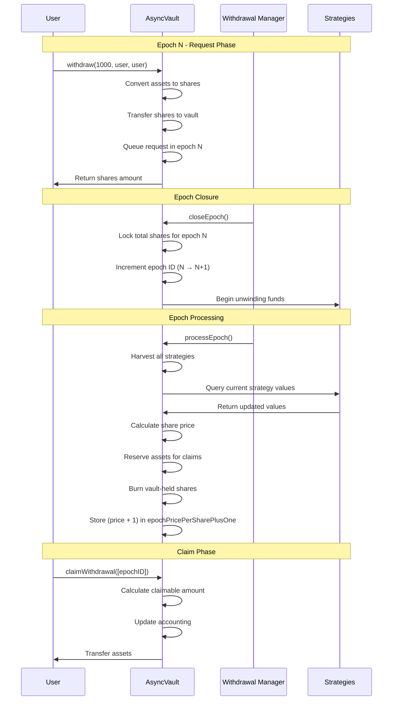
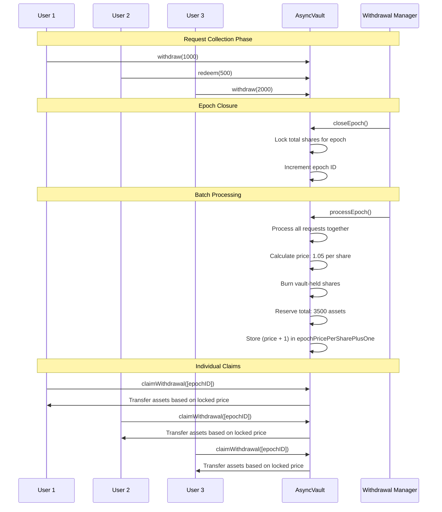
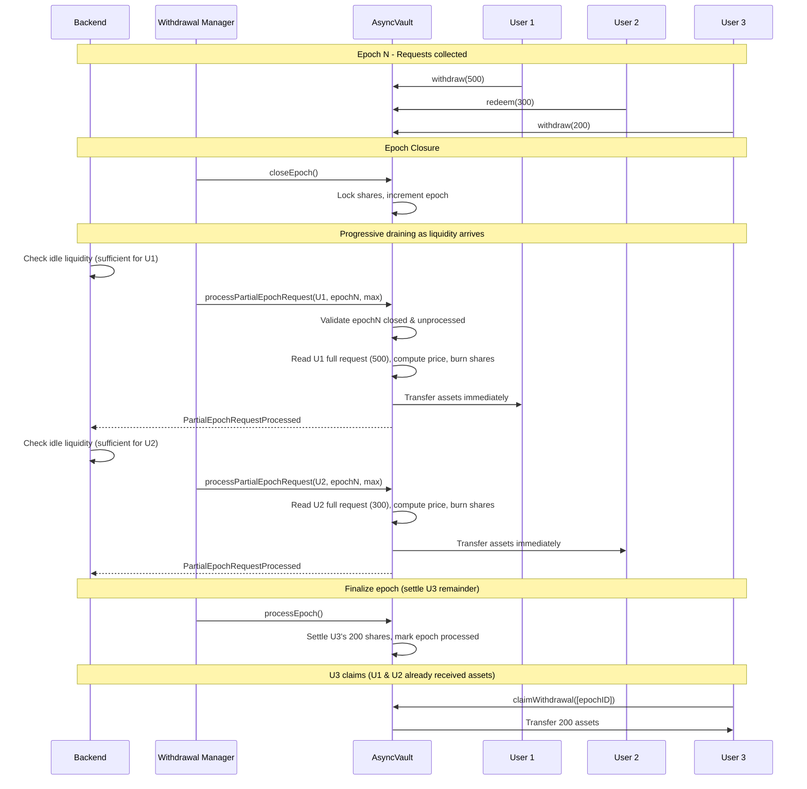

# ConcreteAsyncVaultImpl: Asynchronous Withdrawal System

## Technical Specification

---

## 1. Summary

The ConcreteAsyncVaultImpl introduces an epoch-based asynchronous withdrawal system that addresses liquidity management challenges in vault operations. Unlike traditional ERC4626 vaults where withdrawals execute immediately, this implementation batches withdrawal requests into processing epochs, providing withdrawal manager with controlled liquidity management to fill the queued exits.

---

## 2. Architecture Overview

### 2.1 Core Components

```
┌──────────────────────────────────────────────────────────────────────┐
│                     ConcreteAsyncVaultImpl                           │
├──────────────────────────────────────────────────────────────────────┤
│  ┌─────────────────┐  ┌────────────────────────┐  ┌─────────────────┐│
│  │  User Interface │  │    Withdrawal Mgr      │  │  Vault Manager  ││
│  │                 │  │                        │  │                 ││
│  │ • withdraw()    │  │ • closeEpoch()         │  │ • toggleQueue   ││
│  │ • redeem()      │  │ • processEpoch()       │  │   Active()      ││
│  │ • claim()       │  │ • processPartial       │  │ • configure()   ││
│  │ • cancel()      │  │   EpochRequest()       │  │  (cancellation) ││
│  │                 │  │ • moveRequest          │  │                 ││
│  │                 │  │   ToNextEpoch()        │  │                 ││
│  │                 │  │ • claimForUser()       │  │                 ││
│  │                 │  │ • cancelForUser()      │  │                 ││
│  │                 │  │ • claimUsersBatch()    │  │                 ││
│  └─────────────────┘  └────────────────────────┘  └─────────────────┘│
├──────────────────────────────────────────────────────────────────────┤
│                      ConcreteStandardVaultImpl                       │
│                (Strategy Management & Base Functionality)            │
└──────────────────────────────────────────────────────────────────────┘
```

### 2.2 State Architecture

The async vault maintains additional state using a dedicated storage library (`ConcreteAsyncVaultImplStorageLib`) following ERC7201 storage pattern:

```solidity
struct ConcreteAsyncVaultImplStorage {
    // Current epoch ID for async withdrawals
    uint256 latestEpochID;
    // Assets available for past withdrawals (denominated in underlying asset)
    uint256 pastEpochsUnclaimedAssets;
    // Mapping from epoch ID to total shares requested in that epoch
    mapping(uint256 => uint256) totalRequestedSharesPerEpoch;
    // Mapping from user address to epoch ID to shares requested
    mapping(address user => mapping(uint256 epochID => uint256 shares)) userEpochRequests;
    // Mapping from epoch ID to (share price + 1) when that epoch was processed
    // Value of 0 indicates epoch not yet processed; non-zero = actual price + 1
    mapping(uint256 => uint256) epochPricePerSharePlusOne;
    // Whether the queue is active
    bool isQueueActive;
}
```

**Key Storage Changes:**

- **Multi-Epoch Support**: Users can have requests across multiple epochs simultaneously
- **Mapping-Based Design**: `userEpochRequests[user][epoch]` replaces single `RedeemRequest` struct
- **Gas Optimized**: Direct mapping lookups avoid array iterations
- **Storage Library**: Separated into `ConcreteAsyncVaultImplStorageLib.sol` for better architecture
- \*\*Queue toggeling feature: Allows the vault to work as a standard vault

---

## 3. Async Withdrawal Flow

### 3.1 Four-Phase Process

The async withdrawal system operates in four distinct phases:

#### Phase 1: Request Submission

1. Users call overridden ERC4626 functions (`withdraw()` or `redeem()`)
2. Requests are queued in the current epoch (`userEpochRequests[user][currentEpoch] += shares`)
3. Shares are transferred from user to vault
4. Multiple requests per user across different epochs are supported

#### Phase 2: Epoch Closure

1. Withdrawal Manager calls `closeEpoch()` to close the current epoch
2. Locks the total shares requested for the current epoch
3. Epoch can be closed even if empty (no requests)
4. Epoch ID is automatically incremented (rollover to new epoch)
5. Vault begins unwinding funds from strategies to prepare liquidity
6. Users can no longer cancel requests from the closed epoch

#### Phase 3: Epoch Processing

Epoch processing can happen via two complementary paths:

**Path A — Batch processing (`processEpoch()`)**:

1. Withdrawal Manager calls `processEpoch()` to process the closed epoch (`latestEpochID - 1`)
2. All pending requests for that epoch are batched and processed
3. Share price is calculated and locked for that specific epoch
4. Shares are burned from the vault
5. Assets are reserved for users claims
6. Price is stored as `epochPricePerSharePlusOne` (price + 1 to distinguish from unprocessed)

**Path B — Partial epoch processing (`processPartialEpochRequest()`)**:

1. Backend monitors idle liquidity and selects the next request to fulfil from a FIFO queue
2. Backend decides how many of the user's shares to fulfil now (`type(uint256).max` for the entire request)
3. Withdrawal Manager calls `processPartialEpochRequest(user, epochID, amount)`; shares that are not fulfilled stay in the closed epoch
4. Share price is calculated at call time and assets are transferred to the user immediately (no claim step)
5. Shares are burned, user's request and epoch totals are reduced by the fulfilled shares
6. This can be repeated for each request as liquidity becomes available
7. Eventually `processEpoch()` is called to batch-settle any remaining requests and mark the epoch as processed

Paths A and B can be combined: partial fulfilments reduce the epoch's outstanding shares, and `processEpoch()` settles whatever remains.

#### Phase 4: Claim Execution

1. Users call `claimWithdrawal(uint256[] epochIDs)` with array of epochs to claim
2. Assets are distributed based on locked epoch prices (aggregated across epochs)
3. Single transaction burns all shares and transfers all assets for gas efficiency
4. Reserved assets are released from vault

Alternatively, withdrawal manager can claim on behalf of users:

1. Withdrawal Manager calls `claimWithdrawal(user, uint256[] epochIDs)` for specific user
2. Assets are distributed based on locked epoch prices
3. Reserved assets are released from vault

**Note**: Users whose requests were fulfilled via partial epoch processing (Path B) do **not** need to call `claimWithdrawal` — their assets were already transferred at fulfilment time.

### 3.2 State Transitions

```
Epoch N-1: CLOSED       Epoch N-1: PROCESSED   Epoch N: ACTIVE
┌─────────────────┐     ┌─────────────────┐     ┌─────────────────┐
│ • Shares locked │────▶│ • Claims ready  │     │ • Collecting    │
│ • Rollover to   │     │ • Price locked  │     │   requests      │
│   new epoch     │     │ • Assets        │     │ • Users can     │
│ • Start         │     │   reserved      │     │   cancel        │
│   unwinding     │     │ • Next epoch    │     │                 │
│   funds         │     │   can be closed │     │                 │
└─────────────────┘     └─────────────────┘     └─────────────────┘
        │
        │  (alternative: partial epoch processing)
        ▼
┌─────────────────────────────────────────┐
│ Epoch N-1: PARTIAL PROCESSING           │
│ • Individual requests fulfilled         │
│ • Assets transferred immediately        │
│ • Remaining shares decremented          │
│ • Eventually → processEpoch() to        │
│   finalize and mark as PROCESSED        │
└─────────────────────────────────────────┘
```

---

## 4. User Interaction Flows

### 4.1 Standard Withdrawal Request Flow

```
User Journey: Alice wants to withdraw 1000 USDC

1. Alice calls: vault.withdraw(1000e6, alice, alice)
   ├── Vault converts 1000 USDC → ~995 shares (based on current rate)
   ├── Transfers 995 shares from Alice to vault
   ├── Creates/updates RedeemRequest for Alice in current epoch
   └── Emits WithdrawRequested(alice, 1000e6, currentEpoch)

2. Withdrawal Manager calls: vault.closeEpoch()
   ├── Locks total shares requested for the epoch
   ├── Increments epoch ID (rollover to new epoch)
   ├── Epoch can be closed even if empty
   ├── Begins unwinding funds from strategies
   └── Emits EpochClosed(epochId)

3. Alice waits for epoch processing...

4. Withdrawal Manager calls: vault.processEpoch()
   ├── Calculates share price: 1.005 USDC/share
   ├── Burns 995 shares from vault
   ├── Reserves assets: 995 × 1.005 = ~1000 USDC
   ├── Stores epoch price as (price + 1) in epochPricePerSharePlusOne
   └── Emits EpochProcessed(epochId, totalShares, totalAssets, price)

5. Alice calls: vault.claimWithdrawal([epochId])
   ├── Calculates claimable: 995 × 1.005 = ~1000 USDC
   ├── Burns 995 shares from vault
   ├── Transfers 1000 USDC to Alice
   └── Emits RequestClaimed(alice, 1000e6, [epochId])
```

### 4.2 Request Cancellation Flow

```
Before epoch is closed, Alice can cancel specific epoch requests:

1. Alice calls: vault.cancelRequest(epochID)
   ├── Validates request exists in specified epoch
   ├── Validates epoch is not yet closed (only open epochs can be cancelled)
   ├── Returns shares to Alice
   ├── Updates vault accounting for that epoch
   └── Emits RequestCancelled(alice, shares, epochID)

Note: Once an epoch is closed via closeEpoch(), requests can no longer be cancelled.
Note: Cancellation can be switched off per vault by the vault manager via configure(CancellationEnabled, abi.encode(false)) (timelocked). While it is off, both cancelRequest variants revert with CancellationDisabled. Check with cancellationEnabled().

Alternatively, withdrawal manager can cancel requests on behalf of users:

2. Withdrawal Manager calls: vault.cancelRequest(user, epochID)
   ├── Validates user address is not zero
   ├── Validates request exists in specified epoch
   ├── Validates epoch is not yet closed
   ├── Returns shares to the specified user
   ├── Updates vault accounting for that epoch
   └── Emits RequestCancelled(user, shares, epochID)
```

### 4.3 Multi-Epoch Claiming Flow

```
Alice has requests in epochs 5, 7, and 9 (all processed):

1. Alice calls: vault.claimWithdrawal([5, 7, 9])
   ├── Processes epoch 5: calculates assets using locked price
   ├── Processes epoch 7: calculates assets using locked price
   ├── Processes epoch 9: calculates assets using locked price
   ├── Aggregates total assets and shares
   ├── Burns total shares from vault in single operation
   ├── Transfers total assets to Alice in single operation
   └── Emits RequestClaimed(alice, totalAssets, [5, 7, 9])

Alternatively, withdrawal manager can claim on behalf of users:

2. Withdrawal Manager calls: vault.claimWithdrawal(user, [5, 7, 9])
   ├── Validates user address is not zero
   ├── Processes epochs 5, 7, and 9 for the specified user
   ├── Aggregates total assets and shares for the user
   ├── Burns total shares from vault in single operation
   ├── Transfers total assets to the specified user
   └── Emits RequestClaimed(user, totalAssets, epochIDs)
```

### 4.4 Batch User Claiming Flow

```
Withdrawal Manager can process claims for multiple users in a single epoch:

1. Withdrawal Manager calls: vault.claimUsersBatch([user1, user2, user3], epochID)
   ├── Validates users array is not empty
   ├── Validates epoch has been processed (price is locked)
   ├── For each user with requests in the epoch:
   │   ├── Calculates claimable assets using locked epoch price
   │   ├── Clears user's request from the epoch
   │   ├── Transfers assets directly to the user
   │   └── Emits RequestClaimed(user, assets, [epochID])
   ├── Updates vault accounting to release reserved assets
   └── Optimized for gas efficiency with single epoch price lookup
```

### 4.5 Priority Withdrawal Flow

Users who need immediate access to funds can request a priority withdrawal that bypasses the epoch cycle. The operator unwinds the position, deallocates the net amount back to the vault, and calls `claimPriorityWithdrawal`. The unwind cost is deducted from the user's withdrawal and recorded on the strategy via `IAsyncAccounting.adjustTotalAssets`, which the next yield accrual reconciles automatically.

```
Operator fast-track flow:

1. accrueYield()               ← optional, only if exchange rate changed
2. Unwind position              ← off-chain / underlying protocol
3. deallocate(grossAssets - unwindCost)
4. claimPriorityWithdrawal(user, sharesToFulfil, unwindCost, strategy)
   ├── withYieldAccrual modifier runs first
   ├── cachedTotalAssets -= netAssets
   ├── Shares burned, request cleared/reduced
   ├── strategy.adjustTotalAssets(-unwindCost)
   └── netAssets transferred to user
```

- **Role**: `PRIORITY_WITHDRAWAL_EXECUTOR` (not granted by default; assigned by `ROLE_ADMIN`)
- **Unwind cost cap**: Configurable via `setUnwindCostCap` (default 5%)
- **Exchange rate**: Unchanged from the user perspective (`convertToAssets` previews pending yield delta)

See [PriorityWithdrawal.md](PriorityWithdrawal.md) for the full specification.

### 4.6 Partial Epoch Processing Flow

After an epoch is closed, the withdrawal manager can fulfil individual requests progressively as idle liquidity becomes available, rather than waiting for full liquidity to batch-settle the entire epoch via `processEpoch()`. A backend service maintains request ordering via subgraph event indexing and dispatches fulfilments in FIFO order.

```
Epoch N closed, users have pending requests:

1. Backend monitors idle liquidity (vaultBalance - pastEpochsUnclaimedAssets)

2. Backend selects next request in queue order (Alice)
   └── Decides how many of Alice's shares to fulfil now

3. Withdrawal Manager calls: vault.processPartialEpochRequest(alice, epochID, amount)
   ├── withYieldAccrual modifier ensures fresh share price
   ├── Validates epochID is closed and not yet processed (intent check)
   ├── Takes `amount` of Alice's shares (all for type(uint256).max)
   ├── Calculates assets = shares × sharePrice / 10^decimals (floor)
   ├── Validates idle liquidity ≥ assets
   ├── Zeros out Alice's epoch request
   ├── Reduces totalRequestedSharesPerEpoch by shares
   ├── Burns shares from vault
   ├── Reduces cachedTotalAssets by assets
   ├── Transfers assets to Alice immediately
   └── Emits PartialEpochRequestProcessed(alice, epochID, shares, assets)

4. Repeat for next user in queue when liquidity is available...

5. When all requests are drained or enough liquidity exists for the rest:
   Withdrawal Manager calls: vault.processEpoch()
   └── Batch-settles any remaining requests and marks epoch as processed
```

- **Role**: `WITHDRAWAL_MANAGER` (same as `processEpoch` and `closeEpoch`)
- **Parameters**: `address user`, `uint256 epochID`
- **Liquidity source**: Idle vault balance only (no strategy unwinding or unwind cost)
- **Exchange rate**: Preserved — shares burned and assets deducted proportionally
- **Epoch finalization**: Epoch remains in `Processing` state until `processEpoch()` is called, even if all individual requests are fulfilled

See [PartialEpochProcessing.md](PartialEpochProcessing.md) for the full specification.

---

## 5. Sequence Diagrams

### 5.1 Complete Withdrawal Cycle



### 5.2 Multi-User Epoch Processing



### 5.3 Partial Epoch Processing



---

## 6. Enhanced Epoch Management

### 6.1 Epoch Lifecycle Operations

The async vault implementation provides comprehensive epoch management with three key operations:

#### `closeEpoch()`

- **Purpose**: Close the current epoch and transition to the next epoch
- **Functionality**:
  - Locks the total shares requested for the current epoch
  - Increments `latestEpochID` (rollover to new epoch)
  - Can close epoch even if empty (no pending requests)
  - Signals vault to begin unwinding funds from strategies
  - After closure, requests in that epoch can no longer be cancelled
- **Access Control**: Only callable by `WITHDRAWAL_MANAGER` role
- **Modifiers**: `nonReentrant`
- **State Changes**:
  - Increments `latestEpochID`
  - Freezes `totalRequestedSharesPerEpoch[closedEpochID]`
- **Emits**: `EpochClosed(epochID)`

#### `processEpoch()`

- **Purpose**: Process withdrawal requests of the closed epoch
- **Functionality**:
  - Processes the closed epoch `latestEpochID - 1`. A new epoch can only be closed once the previous one is processed, so there is at most one closed, unprocessed epoch
  - Calculates share price using `_convertToAssets()`
  - Validates sufficient liquid assets are available
  - Burns shares held by the vault for this epoch
  - Reserves assets for future claiming
  - Stores (price + 1) in `epochPricePerSharePlusOne[epochID]` to distinguish from unprocessed (0)
- **Access Control**: Only callable by `WITHDRAWAL_MANAGER` role
- **Parameters**: none
- **Modifiers**: `withYieldAccrual`, `nonReentrant`
- **State Changes**:
  - Updates `pastEpochsUnclaimedAssets`
  - Clears `totalRequestedSharesPerEpoch[epochID]`
  - Stores `epochPricePerSharePlusOne[epochID] = price + 1`

#### `moveRequestToNextEpoch(address user, uint256 epochID, uint256 amount)`

- **Purpose**: Move all or part of a user's withdrawal request from the latest closed epoch to the current active epoch
- **Functionality**:
  - Validates that `epochID` matches `latestEpochID - 1` (the closed, unprocessed epoch) — intent-validation parameter
  - Validates the closed epoch is not already processed
  - Moves the specified `amount` of shares (or the full request if `amount == type(uint256).max`) from the closed epoch to the active epoch
  - Updates both epoch request mappings and totals
- **Access Control**: Only callable by `WITHDRAWAL_MANAGER` role
- **Parameters**:
  - `user` — Address of the user whose request to move
  - `epochID` — Must equal `latestEpochID - 1` (intent validation)
  - `amount` — Shares to move; pass `type(uint256).max` to move the entire request
- **State Changes**:
  - Decreases `userEpochRequests[user][closedEpochID]` by shares moved
  - Increases `userEpochRequests[user][latestEpochID]` by shares moved
  - Updates `totalRequestedSharesPerEpoch` for both epochs
- **Emits**: `RequestMovedToNextEpoch(user, sharesToMove, closedEpochID, latestEpochID)`

#### `processPartialEpochRequest(address user, uint256 epochID, uint256 amount)`

- **Purpose**: Fulfil all or part of a user's withdrawal request from a closed-but-unprocessed epoch, transferring assets immediately
- **Functionality**:
  - Validates the provided `epochID` is closed and not yet processed (intent-validation parameter)
  - Takes `amount` shares of the user's request (`type(uint256).max` for all of it); must not exceed the request
  - Computes share price at current exchange rate (via `withYieldAccrual`)
  - Calculates assets using floor rounding (protocol-favourable)
  - Validates sufficient idle liquidity (vault balance minus `pastEpochsUnclaimedAssets`)
  - Burns the fulfilled shares and reduces the request by them
  - Transfers assets to the user immediately (no separate claim step)
  - Shares that are not fulfilled stay in the closed epoch and are settled by `processEpoch()`
- **Access Control**: Only callable by `WITHDRAWAL_MANAGER` role
- **Parameters**:
  - `user` — Address of the user whose request to fulfil
  - `epochID` — The closed epoch to target (must be closed and not yet processed)
  - `amount` — Shares to fulfil; `type(uint256).max` for the entire request
- **Modifiers**: `withYieldAccrual`, `nonReentrant`
- **State Changes**:
  - Zeros out `userEpochRequests[user][epochID]`
  - Decreases `totalRequestedSharesPerEpoch[epochID]` by the user's shares
  - Decreases `cachedTotalAssets` by the calculated assets
  - Burns the user's shares held by the vault
- **Emits**: `PartialEpochRequestProcessed(user, epochID, shares, assets)`

See [PartialEpochProcessing.md](PartialEpochProcessing.md) for the full specification.

#### **Use Cases for Epoch Management**

1. **Liquidity Management**: Close epochs to begin unwinding, move requests when insufficient liquidity
2. **User Assistance**: Help users who need to delay their withdrawals
3. **Operational Flexibility**: Manage withdrawal timing based on market conditions
4. **Emergency Handling**: Process epochs out of order if needed, move requests during operational issues
5. **Empty Epochs**: Close empty epochs to advance the system even without pending requests
6. **Progressive Draining**: Fulfil individual requests as idle liquidity arrives via partial epoch processing, reducing average user wait time

#### **Processing Flow Example**

```solidity
// Example: Standard epoch lifecycle
vault.closeEpoch(); // Close current epoch, increment to next

// Wait for liquidity to be arranged...

vault.processEpoch(); // Process the closed epoch

// Example: Moving a user's full request to next epoch
vault.moveRequestToNextEpoch(userAddress, closedEpochID, type(uint256).max);

// Example: Partial epoch processing (progressive draining)
vault.closeEpoch(); // Close current epoch

// Fulfil Alice's full request
vault.processPartialEpochRequest(alice, closedEpochID, type(uint256).max);

// Fulfil only 200 of Bob's shares; the rest is settled by processEpoch()
vault.processPartialEpochRequest(bob, closedEpochID, 200);

// Finalize the epoch (settle remainder, mark as processed)
vault.processEpoch();
```

#### **Technical Constraints**

- `closeEpoch()` can only close the current (latest) epoch
- `processEpoch()` processes the closed epoch `latestEpochID - 1` if it hasn't been processed yet
- Each epoch can only be processed once (prevents double processing)
- Epochs must be closed before they can be processed
- Sufficient vault liquidity must be available for processing
- Share prices are locked at the time of processing, not at request or closure time
- `epochPricePerSharePlusOne` value of 0 means unprocessed, non-zero means processed (subtract 1 for actual price)
- `processPartialEpochRequest()` fulfils `amount` shares of the user's request (`type(uint256).max` for all of it)
- `moveRequestToNextEpoch()` only moves from the latest closed epoch (`latestEpochID - 1`) to the current active epoch; accepts an `amount` parameter (or `type(uint256).max` for all)
- `processPartialEpochRequest()` validates the provided `epochID` is closed and not yet processed, and does not mark the epoch as processed
- Individual fulfilments and batch `processEpoch()` can be freely combined; `processEpoch()` settles whatever shares remain after individual fulfilments

### 6.3 Operational Benefits

#### **For Withdrawal Manager**

- **Epoch Control**: Separate epoch closure from processing allows better liquidity planning
- **Liquidity Planning**: Close epochs to signal unwinding, then process when liquidity is ready
- **Risk Management**: Process epochs only when sufficient liquidity is confirmed
- **Batch Efficiency**: Handle multiple epochs in planned operational windows
- **Emergency Handling**: Address processing backlogs without losing user requests, process out of order if needed
- **Operational Flexibility**: Close new epochs even when previous epochs need more time for liquidity arrangement
- **Empty Epoch Support**: Close empty epochs to advance the system even without pending requests
- **Progressive Draining**: Fulfil individual requests via `processPartialEpochRequest()` as idle liquidity arrives, reducing average user wait time without requiring full epoch liquidity upfront. Use `moveRequestToNextEpoch()` to defer a portion of a request when liquidity only covers part of it

#### **For Users**

- **Batch Claiming**: Claim multiple epochs in single transaction for gas efficiency
- **Fair Pricing**: All users in same epoch get identical share price regardless of processing timing
- **Request Flexibility**: Can cancel requests from open epochs (before `closeEpoch()` is called) using `cancelRequest(epochID)`
- **ERC4626 Compliance**: `maxWithdraw()` and `maxRedeem()` return expected values for integration compatibility
- **Allowance Support**: Third parties can make withdrawals on behalf of users with proper ERC20 allowances
- **Withdrawal Manager Assistance**: Withdrawal manager can cancel or claim requests on behalf of users when needed

---

## 7. Technical Implementation Details

### 7.1 Price Calculation

Share price is determined at epoch processing time using the vault's current state:

```solidity
uint256 sharePrice = _convertToAssets(10 ** decimals(), Math.Rounding.Floor);
```

This ensures all users in the same epoch receive the same conversion rate, regardless of when they submitted their request or when they claim.

The price is stored as `(sharePrice + 1)` in `epochPricePerSharePlusOne` to distinguish processed from unprocessed epochs:

```solidity
// Storing the price
epochPricePerSharePlusOne[epochID] = sharePrice + 1;

// Retrieving the price
uint256 storedValue = epochPricePerSharePlusOne[epochID];
if (storedValue == 0) {
    revert EpochNotProcessed(epochID);
}
uint256 actualPrice = storedValue - 1;
```

This mechanism allows checking if an epoch has been processed (non-zero value) versus unprocessed (zero value) without requiring additional state variables.

### 7.2 Asset Reservation

When an epoch is processed, assets are reserved to guarantee claim fulfillment:

```solidity
uint256 assetsNeeded = requestingShares.mulDiv(
    sharePrice,
    10 ** decimals(),
    Math.Rounding.Floor
);
pastEpochsUnclaimedAssets += assetsNeeded;
```

Floor operation is used - any rounding error benefits the protocol. When individual withdrawals are claimed by the users they are also rounded down. The sum of all claimed withdrawals is guaranteed to be less or equal the assetsNeeded due to the applied rounding. (N floor operations on N parts will sum to a number less or equal the original number after floor operation).

### 7.3 Liquidity Management

The vault checks available liquidity before processing an epoch:

```solidity
uint256 availableAssets = IERC20(asset()).balanceOf(address(this));
if (availableAssets < pastEpochsUnclaimedAssets + assetsNeeded) {
    revert InsufficientBalance();
}
```

### 7.4 ERC20 Allowance Integration

The async vault properly handles ERC20 allowances for third-party withdrawals:

```solidity
function _executeWithdraw(address caller, address receiver, address owner, uint256 assets, uint256 shares) {
    if ($.isQueueActive) {
        if (caller != owner) {
            _spendAllowance(owner, caller, shares);  // ERC20 allowance check
        }
        // ... async withdrawal logic
    } else {
        return super._executeWithdraw(caller, receiver, owner, assets, shares);
    }
}
```

This ensures that:

- **Owner withdrawals**: No allowance required (caller == owner)
- **Third-party withdrawals**: Proper allowance validation and spending
- **Security**: Prevents unauthorized withdrawals
- **ERC4626 compliance**: Follows standard allowance patterns
