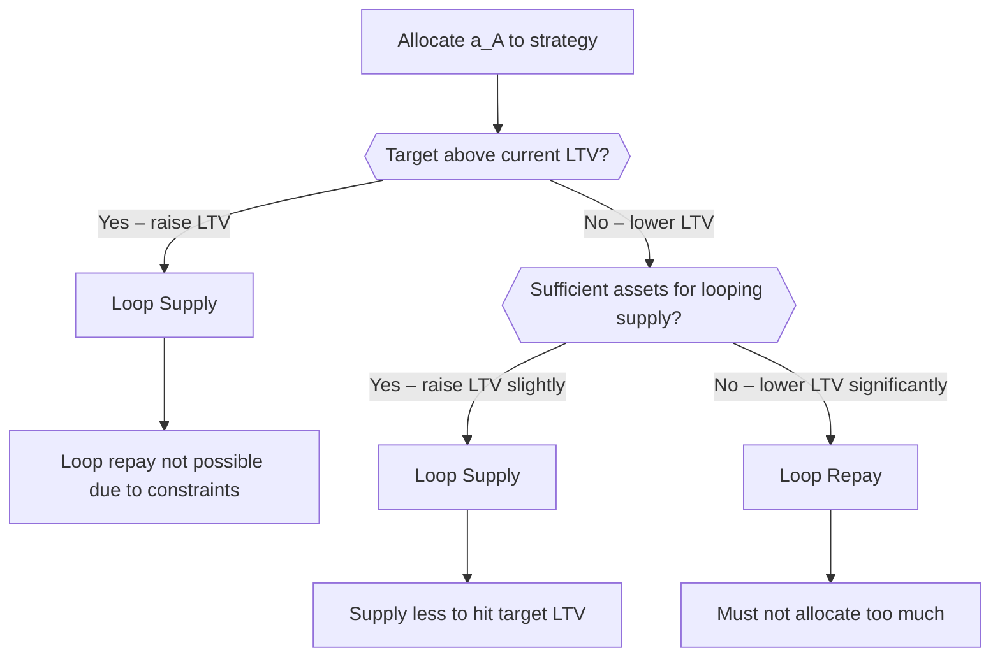
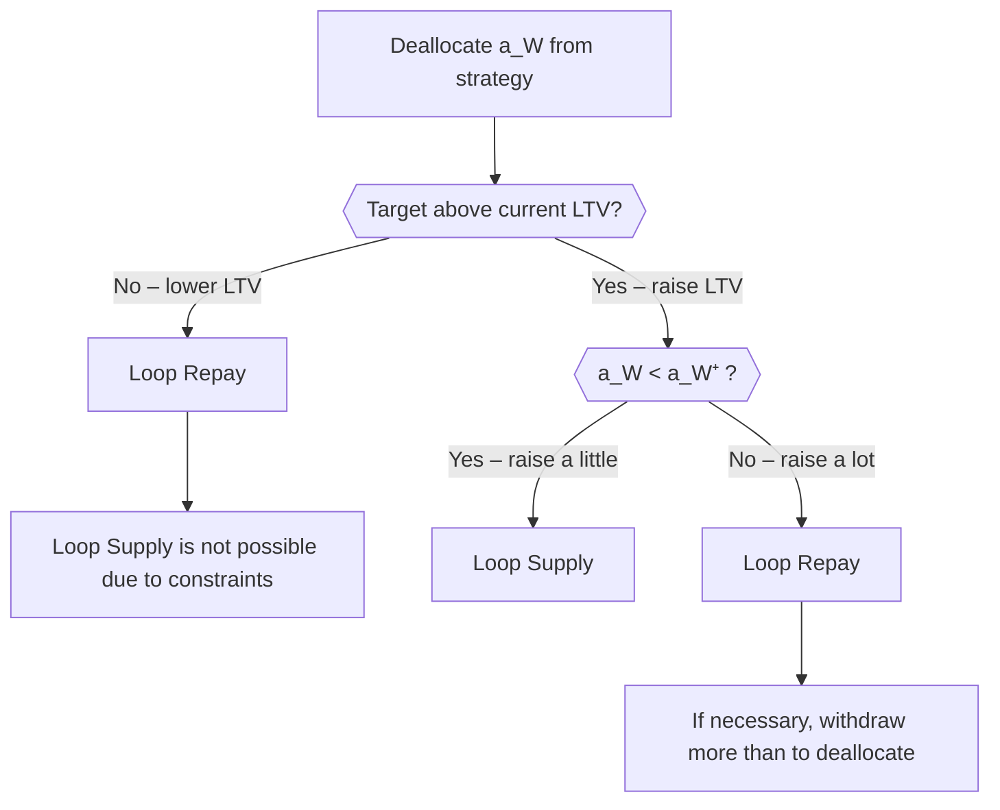

## 1. Overview

### 1.1. Architecture

The purpose of the looping strategy is to increase exposure to an asset by leveraging an auxiliary asset as a debt token at a lending market.

The strategy is built in a modular fashion that allows for a high degree of customization.

The motor of the strategy is an independent contract called the `LoopingPrimitive` (_./src/periphery/strategies/LoopingPrimitive.sol_), it abstracts the task of leveraging and deleveraging using flash loans. By itself it is agnostic about the context in which it is used/inherited. It just needs to have access to three functionalities: a **flash provider**, a **swap provider** and a **lender**. These requirements are solved by a **flash module**, a **swap module** and some virtual internal lender operations for supplying, withdrawing, borrowing and repaying. Whilst the specifics of the flash and the swap are effectively a black box to the looping primitive, the specifics of the lender integration should be accessible to and modifiable by any inheriting contract.

The next layer of the strategy is the integration with the concrete-earn-v2 environment. It must work together with the v2 requirements. In particular it must be able to report the total assets under management, the max withdrawable amount, and other view and preview functions. It must also be able to receive funds through allocation and have funds removed via deallocation or user withdrawal. Those functionalities are made available through the `BaseStrategy` (_./src/periphery/strategies/BaseStrategy.sol_) contract. Some of the internal functions have to be overridden to adjust the strategy for looping. Finally the last layer consists of an implementation of the lender functionalities and of the various control mechanisms, i.e. functions that can handle the adjustment of the leverage, the winding up or down of the position or the rescue of locked funds. The lender functionalities can also have custom logic, but at this level we also abstract away the specifics of the various lenders by **lender modules**. Those can be plugged in and used as black boxes for supplying, withdrawing, borrowing and repaying, however with optional bespoke logic before and after. All together these three layers make up the `BaseLoopingStrategy` (_./src/periphery/strategies/BaseLoopingStrategy.sol_). Any customization, such as extra variables, extra view functions, or extra lender integrations have to be added on top and/or modify some of the virtual functions.

A key premise of the looping strategy is that the loan-to-value ratio (ltv) should be kept within a certain range of values. These values are supplied as state variables.

Another key premise is that every looping strategy can be converted into a simple lender strategy that just supplies and withdraws without entering into a debt position. Looping can be enabled and disabled. It is recommended to have an existing position at the lender when enabling the looping so that the ltv adjustment can work without problems.

The `BaseLoopingStrategy` also has another constant, namely that it does not hold any borrow or debt tokens. Whilst it may do so intermediarily, the balance has to be kept zero at the end of any transaction. This eases accounting and accountability but also allows for the code complexity to be reduced.

To keep the strategy healthy one may adjust the leverage. There is a permissionless function without arguments which uses a target LTV and a preset max slippage and there is a permissioned function where the target parameters can be provided as arguments. That function also allows emergency unwinding by setting the target ltv to zero and the slippage quite permissive. The permissionless feature can be switched on or off in case the admin wants full control.

Those target values as well as the bandwidth of allowable LTVs are set as state variables when the looping is enabled. But they can also be changed by an admin.

There are various view and preview functions. The total assets is returned as the equity of the position adjusted for the cost of unwinding. Thus the provided slippage parameter does factor into the value of the position. One may also preview the required flash liquidity and the resulting collateral for an ltv adjustment. In fact also the allocation, deallocation and withdrawal functions can be previewed. There is one single function that does it, which is called `previewOperation`.

```
                                          ┌──────────────────────┐
                                          |        Concrete      |
                                          |    LoopingStrategy   |
                                          └──────────────────────┘ 
                                                     ▲
                                                     |
                                          ┌──────────────────────┐          ┌──────────────────────┐
        ┌──────────────────────┐          |                      |          |                      |
        |   Lender Module      | ──────→  | BaseLoopingStrategy  |  ←─────  |     BaseStrategy     |
        └──────────────────────┘          |                      |          |                      |
                                          └──────────────────────┘          └──────────────────────┘
                                                     ▲
                                                     |
        ┌──────────────────────┐          ┌──────────────────────┐
        │   Flash Module       │ ──────→  |                      |          ┌───────────────────────┐
        ├──────────────────────┤          |    LoopingPrimitive  |  ←─────  |  LoopingPrimitiveLib  |
        │   Swap Module        │ ──────→  |                      |          └───────────────────────┘
        └──────────────────────┘          └──────────────────────┘                                              
```

### 1.2. Basic Interactions 

#### 1.2.1 Allocating to the Strategy

Allocation to the strategy is very standard. Just encoding the amount to be allocated.

Then the funds are either sent directly into the lender, if looping is disabled, or leveraged if looping is enabled. In the latter case, first the looping parameters are prepared, then a quote for looping is requested, then a flash loan is received, then funds are sent to the lender and a corresponding amount is taken out of the lender to keep the ltv at the target. Then the appropriate amount is swapped back to service the flash loan. Finally a check is conducted to make sure that the ltv really is within bounds.

### 1.2.2. Deallocating from the Strategy

Deallocation from the strategy involves removing funds from the lender position. If looping is disabled, funds are simply withdrawn from the lender. If looping is enabled, the position may need to be deleveraged first to free up the required amount. This involves reducing the debt position and adjusting the collateral accordingly, using flash loans to facilitate the process. The ltv is maintained within acceptable bounds throughout the operation.

#### 1.2.3. Withdrawing from the Strategy

Withdrawal from the strategy follows a similar pattern to deallocation. Funds need to be made available from the lender position. If looping is disabled, the withdrawal is straightforward. If looping is enabled, the position may need to be adjusted to free up the requested amount, which could involve reducing leverage. The operation ensures that the remaining position maintains a healthy ltv ratio.

## 2. What is Looping?

Anyone who wants to go long on a particular asset has played with the idea (or executed upon it) to borrow against it on a defi lending protocol, swapping the borrowed amount back into that asset thus increasing your exposure to the asset beyond the original amount. This process can be repeated several times and is called looping. Looping is one way of increasing the leverage. The multiplicative factor of how much bigger the exposure is compared to the equity is called leverage factor.

There are other ways to achieve such a leverage factor. Many defi protocols offer flash-loans, which allow users to loan assets which in the simplest form have to be repaid within the same transaction without supplying any collateral, only at the cost of a certain premium. In fact it is possible to reproduce any looped position by using a flash loan. One can even achieve certain limiting positions that could only be achieved by infinite looping, merely by flash loaning. Since the idea of looping is so pervasive in defi, achieving a looped position through a flashloan is nowadays also simply called looping.

How can flashing reproduce leverage or deleverage by looping? Suppose we started with a certain amount $X$ of principal tokens that we wish to use as collateral at the lender and loop by borrowing, swapping, resupplying several times using a specific borrow token. We achieve a position with a larger amount say $3*X$ of collateral at the lender, and say an equivalent of $2*X$ in debt. The equity is still $X$, namely collateral minus debt. But the leverage is 3-fold. This same position can be achieved by flashing an amount $2*X$, supplying $3*X$, namely the original $X$ plus those extra $2*X$, and then borrowing the equivalent of $2*X$ in borrow tokens, which would result in a loan-to-value ratio of 2/3. The $2*X$ borrow tokens are swapped back into principal tokens and sent back to the flash provider. All in one transaction. Of course there is slippage and there are usually fees involved in flashing, hence the details are slightly different and one might have to account for this by flashing slightly more, borrowing slightly more, achieving the same loan-to-value ratio, but being able to cover slippage and flash-fees. The same logic also applies for the reverse direction.

The Concrete Onchain Looping Strategy uses flash loans to get in and out of a leverage position, rather than repeated loops.

## 3. Looping Config and Looping Modalities

The looping strategy supports various configurations and modalities for managing leverage positions. The configurations are strategy parameters set by the admin. The loop modalities are operation specific parameters regarding the leverage. The loop modality is assigned during the preparation of an operation.

### 3.1. Allocation Modes

The default behavior for allocating to the strategy is to loop supply (wind up), which increases leverage and typically increases the LTV. However, if one would like to decrease the LTV while allocating, one can allocate and loop repay (wind down). The user doesn't need to make that choice explicitly; the algorithm determines the appropriate mode based on a threshold. This threshold depends on the target LTV in relation to the current LTV, and also depends on the size of the allocation. If the threshold is exactly hit, then no leverage is required at all and the funds are simply supplied directly to the lender.

### 3.2. Deallocation Modes

The default behavior for deallocating from the strategy is loop repay (wind down), which reduces leverage and typically decreases the LTV. However, if one would like to increase the LTV while deallocating, one can deallocate and loop supply (wind up). Again, there is a threshold that determines the appropriate mode. This threshold depends on the target LTV in relation to the current LTV, and also depends on the size of the deallocation. If the threshold is exactly hit, then no leverage adjustment is required.

### 3.3. Summary of Modes

In summary, there are four main operational modes:

1. **Allocate and loop supply** - Default allocation mode that increases leverage
2. **Allocate and loop repay** - Allocation mode that decreases LTV while adding funds
3. **Deallocate and loop supply** - Deallocation mode that increases LTV while removing funds
4. **Deallocate and loop repay** - Default deallocation mode that decreases leverage

Additionally, there are two singular edge cases when the threshold is exactly hit, where no leverage adjustment is required and the operation proceeds as a simple supply or withdrawal without looping.

## 4. Specifications and Invariants

### 4.1. Core Invariants

The looping strategy maintains several critical invariants that must hold at all times:

#### 4.1.1. Zero Borrow Token Balance Invariant

**Invariant:** The strategy must not hold any borrow tokens at the end of any transaction.

- While borrow tokens may be held intermediately during flash loan operations, the balance must be zero at transaction completion
- This invariant simplifies accounting and prevents accumulation of debt tokens in the strategy contract
- Any borrow tokens received (e.g., from swaps or flash loans) must be immediately used for repayment or swapped back to collateral tokens

#### 4.1.2. Zero Collateral Token Balance Invariant

**Invariant:** The strategy must not hold any collateral tokens at the end of any transaction (except when staged at the lender module).

- Collateral tokens may be held intermediately during operations, but must be either:
  - Supplied to the lender position
  - Staged at the lender module (via `ILenderStaging.stage()`)
  - Withdrawn/deallocated to the vault
- This prevents inflation attacks where surplus funds from swaps could remain in the strategy and artificially inflate the share price
- The only exception is tokens staged at the lender module, which are tracked separately and can be engaged into the position or sent to the vault/admin at any time

#### 4.1.3. LTV Bounds Invariant

**Invariant:** The current LTV must remain within the acceptable bounds defined by target LTV ± deviation.

- Lower bound: $\lambda_{min} = \max(0, \lambda^\star - \delta)$
- Upper bound: $\lambda_{max} = \min(\lambda_{lender}, \lambda^\star + \delta)$
- Where $\lambda^\star$ is the target LTV, $\delta$ is the additive deviation, and $\lambda_{lender}$ is the lender's maximum LTV
- Operations that would violate these bounds will revert
- Permissionless leverage adjustment can be triggered when LTV falls outside these bounds (if enabled)

### 4.2. Position Accounting

The strategy tracks three distinct asset locations:

1. **Lender Position** (`c`, `d`): Collateral supplied and debt borrowed at the lender
2. **Floating Amount** (`a_f`): Collateral tokens temporarily held in the strategy contract during operations
3. **Staged Amount**: Collateral tokens staged at the lender module, available for future engagement or withdrawal

The total position value is calculated as:
$$\text{Position Value} = c - \frac{d \cdot F}{\pi}$$

Where $F$ accounts for the cost of unwinding (flash premium and slippage).

## 5. Operational Flows

### 5.1. Strategy Initialization and Lifecycle

#### 5.1.1. Construction

The strategy is initialized with:
- A lender module address (required)
- Integration with the Concrete Earn V2 vault system
- Initial state: looping disabled, operating as a simple lender strategy

#### 5.1.2. Enabling Looping

To enable looping functionality, an admin calls `enableLooping()` with:
- Flash module address
- Swap module address
- Target LTV (`targetLtvInWad`)
- Flash collateral epsilon (minimum flash amount for operations)
- LTV additive deviation (`ltvAdditiveDeviationInWad`)
- Maximum slippage (`maxSlippageInWad`)
- Permissioned LTV adjustment flag

**Recommendation:** Enable looping when there is already an existing position at the lender, as this allows the LTV adjustment to work smoothly without edge cases.

#### 5.1.3. Disabling Looping

An admin can disable looping by calling `disableLooping()`. This:
- Removes approvals from the lender module
- Sets the looping flag to false
- The strategy reverts to operating as a simple lender strategy (supply/withdraw only, no debt)

**Note:** The strategy must have no funds in the lender module before changing to a new lender module.

### 5.2. User Deposit and Allocation Flow

#### 5.2.1. User Deposits to Vault

1. User deposits assets to the Concrete Earn V2 vault
2. Vault mints shares to the user
3. Vault calls the allocator to allocate funds to strategies
4. Allocated funds are immediately wound up (or even down if the target ltv position requires) 

Note: One can preview the slippage and/or costs of an allocation and the allocator can adjust the amounts into tranches.

#### 5.2.2. Allocation by Allocator

1. Allocator calls `vault.allocate()` on the looping strategy
2. Strategy receives the allocation amount
3. If looping is disabled:
   - Funds are directly supplied to the lender via `_supply()`
   - No leverage is applied
4. If looping is enabled:
   - Strategy computes loop parameters based on target LTV and current position
   - Determines the appropriate loop modality (supply or repay, i.e. wind up or down)
   - Executes flash loan operation to achieve target LTV
   - Any surplus funds from swaps are staged at the lender module
   - Final LTV is verified to be within bounds

### 5.3. User Withdrawal Flow

User withdrawals can occur in two scenarios:

#### 5.3.1. Case 1: Funds Available Within Bounds

When sufficient floating amount exists or the withdrawal can be satisfied without exceeding LTV bounds:

1. User requests withdrawal from vault
2. Vault calls `strategy.onWithdraw(assets)`
3. If looping is disabled:
   - Strategy withdraws directly from lender via `_withdraw()`
4. If looping is enabled:
   - Strategy checks if withdrawal can be satisfied with available floating amount
   - If yes, transfers floating amount directly (plain operation)
   - If withdrawal would exceed LTV bounds, performs loop repay to free up funds
   - Any surplus funds are staged
   - Remaining floating amount (after withdrawal) is staged

#### 5.3.2. Case 2: Funds Not Available Within Bounds

When withdrawal requires deleveraging:

1. Strategy detects insufficient floating amount or LTV bound violation
2. Computes required loop repay operation
3. Executes flash loan to:
   - Repay debt
   - Withdraw collateral
   - Swap to service flash loan
4. Verifies final LTV is within bounds
5. Stages any surplus funds
6. Transfers requested amount to vault

**Special Case - Full Withdrawal:** When the entire position is withdrawn:
- Target LTV is temporarily set to 0
- All debt must be repaid (no debt remains)
- All collateral is withdrawn
- This ensures complete unwinding of the position

### 5.4. Deallocation Flow

#### 5.4.1. Standard Deallocation

1. Allocator calls `strategy.deallocateFunds(amount)` or `strategy.deallocateFunds(type(uint256).max)` for max deallocation
2. If looping is disabled:
   - Strategy withdraws directly from lender
3. If looping is enabled:
   - Strategy computes loop parameters
   - If max deallocation is requested, target LTV is set to 0
   - Executes appropriate loop operation (supply or repay)
   - Stages surplus funds
   - Verifies LTV bounds

#### 5.4.2. Max Deallocation

When `type(uint256).max` is passed:
- Strategy calculates position value
- Sets target LTV to 0 (full unwinding)
- Deallocates entire position value
- Ensures no debt remains

### 5.5. Leverage Adjustment Flows

#### 5.5.1. Permissionless Leverage Adjustment

When permissionless adjustment is enabled (`permissionedLtvAdjustment = false`):

1. Any user can call `adjustLeverage()` (no arguments)
2. Strategy checks if LTV is outside bounds
3. If within bounds, reverts with `LtvWithinBounds` error
4. If outside bounds:
   - Uses stored target LTV and max slippage
   - Executes loop operation to bring LTV to target
   - Stages surplus funds
   - Verifies final LTV is within bounds

**Conditions for Permissionless Adjustment:**
- Looping must be enabled
- `permissionedLtvAdjustment` must be `false`
- Current LTV must be outside the acceptable bounds

#### 5.5.2. Permissioned Leverage Adjustment

An operator (with `OPERATOR_ROLE`) can call `adjustLeverage(maxSlippageInWad, targetLtvInWad, setNewTargetLtv)`:

1. Operator provides custom target LTV and slippage
2. If `setNewTargetLtv = true`:
   - Updates stored target LTV
   - Uses new target for adjustment
3. If `setNewTargetLtv = false`:
   - Uses provided target for this operation only
   - Does not update stored target
4. Executes loop operation
5. Stages surplus funds
6. Verifies LTV bounds

**Emergency Unwinding:** Operator can set `targetLtvInWad = 0` with high slippage to fully unwind the position in emergencies.

#### 5.5.3. Toggling Permissionless Adjustment

An admin can toggle permissionless adjustment:
- `permissionedLtvAdjustment(true)`: Only operators can adjust leverage
- `permissionedLtvAdjustment(false)`: Anyone can adjust when LTV is out of bounds

This provides flexibility between automated maintenance and full admin control.

### 5.6. Lender Module Management

#### 5.6.1. Setting New Lender Module

An admin can change the lender module by calling `setLenderModule(newLenderModule)`:

1. Validates new lender module:
   - Collateral token must match strategy asset
   - Borrow token must be different from collateral token
   - Borrow token must not be zero address
2. Checks previous lender module has no funds (reverts if funds exist)
3. Removes approvals from previous lender module
4. Sets new lender module
5. Grants approvals to new lender module

**Note:** The borrow token can be different from the previous lender module, allowing migration to different lending protocols or token pairs.

#### 5.6.2. Parameter Setters and Views

While looping is enabled, `STRATEGY_ADMIN` can adjust the parameters without disabling it:
- `setTargetLtvAndDeviation(targetLtvInWad, ltvAdditiveDeviationInWad)`: target LTV and the allowed band around it
- `setMaxSlippage(maxSlippageInWad)`: maximum slippage for leverage adjustments and unwinds

Views: `getConfig()`, `loopingIsEnabled()`, `getTargetLtvInWad()`, `getLtvAdditiveDeviationInWad()`, `getMaxSlippageInWad()`, `getCurrentLtvInWad()`, `getLenderPosition()`, `checkLeverageCondition()` (whether the current LTV is outside the band), `maxDeallocate(targetLtvInWad, maxSlippageInWad)` and `maxWithdraw()`. The configured modules are returned by `lenderModule()`, `flashModule()` and `swapModule()`.

## 6. Surplus Handling and Staging

### 6.1. Problem: Inflation Attacks

During swap operations, surplus funds may remain due to:
- Favorable slippage (receiving more than expected)
- Rounding in favor of the strategy
- Price movements during execution

If these surplus funds remain in the strategy contract, they would:
- Artificially inflate the share price
- Create accounting discrepancies
- Allow attackers to exploit the surplus for personal gain

### 6.2. Solution: Staging Mechanism

After every looping operation, the strategy:

1. Calculates unused floating amount:
   - For deallocations: `floatingAmountUnused = floatingAmountCurrent - allocOrDeallocAmount`
   - For allocations: `floatingAmountUnused = floatingAmountCurrent`
2. Calls `ILenderStaging(lenderModule).stage(floatingAmountUnused)`
3. Staged funds are tracked separately at the lender module

### 6.3. Staged Funds Management

Staged funds can be:

1. **Engaged into Position:** Admin/operator can call `lenderModule.engage(amount)` to supply staged funds to the lender position
2. **Sent to Vault/Admin:** Admin can call `lenderModule.send(amount)` to transfer staged funds to the vault or admin address
3. **Queried:** Anyone can call `lenderModule.staged()` to view the staged amount

### 6.4. Edge Case: Full Deallocation/Withdrawal with Yield

When all funds are deallocated or withdrawn, but some amount remains as yield:

1. Strategy unwinds position to zero LTV
2. All debt is repaid
3. All collateral is withdrawn
4. Any remaining surplus (from favorable swaps or yield) is staged
5. This prevents hyper-inflation of share price when position value is zero

**Example:** If position value is 1000 tokens but 1005 tokens are received after unwinding (due to yield), the extra 5 tokens are staged rather than remaining in the strategy.

## 7. Emergency Functions

### 7.1. Emergency Debt Repayment

Operators can use `adjustLeverage()` with:
- `targetLtvInWad = 0`
- High `maxSlippageInWad` (e.g., 0.1 WAD = 10%)
- `setNewTargetLtv = true`

This fully unwinds the position, repaying all debt and withdrawing all collateral.

### 7.2. Emergency Supply

Operators can use `adjustLeverage()` with:
- High `targetLtvInWad` (up to lender max)
- Appropriate `maxSlippageInWad`
- `setNewTargetLtv = true`

This increases leverage to the maximum safe level.

### 7.3. Rescue Funds

Admins can call `rescueFunds(token, amount)` to recover:
- Tokens accidentally sent to the strategy
- Tokens that are not the strategy's asset
- Stuck tokens from failed operations

**Restriction:** Cannot rescue the strategy's asset token (prevents draining the strategy).

### 7.4. Module Updates

Admins can update modules:
- `setFlashModule(address)`: Update flash loan provider
- `setSwapModule(address)`: Update swap provider
- `setLenderModule(address)`: Update lender (requires no funds in previous module)

## 8. Rounding Considerations

### 8.1. Reciprocal Value Rounding

The strategy uses careful rounding for reciprocal values to maintain mathematical consistency:

#### 8.1.1. F and 1/F

- $F = \frac{1+p}{1-f^{\max}}$ is calculated with standard rounding
- $1/F$ is calculated with **ceiling rounding** to ensure:
  - Unity equation: $F \cdot (1/F) \geq 1$ (rounded up)
  - Conservative estimates for debt calculations

**Example:**
```solidity
uint256 OneOverF = WAD.mulDiv(WAD, F, Math.Rounding.Ceil);
```

#### 8.1.2. Collateral Price and LTV

- `collateralPriceInRay` is used with **ceiling rounding** when converting debt to collateral
- `currentLtv` calculations use appropriate rounding to ensure:
  - Debt is never underestimated
  - LTV bounds are conservatively enforced

**Example:**
```solidity
uint256 debtAmountInCollateral = params.debtAmount.mulDiv(
    RAY, 
    params.collateralPriceInRay, 
    Math.Rounding.Ceil
);
```

### 8.2. Rounding Direction Strategy

The strategy uses rounding in opposite directions for reciprocal operations:

- **Forward operations** (collateral → debt): Use ceiling rounding (overestimate)
- **Reverse operations** (debt → collateral): Use ceiling rounding (overestimate)
- **Reciprocal calculations** (1/F, 1/LTV): Use ceiling rounding (overestimate)

This ensures:
- No underflow in calculations
- Conservative position valuations
- Safety margins in LTV bounds
- Unity equations are satisfied (e.g., $F \cdot (1/F) \geq 1$)

### 8.3. Impact on Operations

Rounding affects:
- **Position Value:** Conservative estimates prevent overvaluation
- **LTV Calculations:** Ensures debt is never underestimated
- **Flash Loan Quotes:** Conservative estimates prevent insufficient repayment
- **Max Withdraw/Deallocate:** Conservative estimates ensure operations are always feasible

### 8.4. Invalid LTV Condition

When calculating the new LTV after a withdrawal using `newLtvAfterWithdrawInWad()`, the LTV becomes invalid/infinite when:

$$1/\lambda_{new} = 1/\lambda_{old} - \frac{a_w \cdot \pi}{d} \leq 0$$

This occurs when:
$$\frac{a_w \cdot \pi}{d} \geq \frac{1}{\lambda_{old}}$$

Which simplifies to:
$$a_w \cdot \pi \cdot \lambda_{old} \geq d$$

Since $\lambda_{old} = \frac{d}{c \cdot \pi}$, this becomes:
$$a_w \geq c$$

**In words:** The LTV becomes invalid when the withdrawal amount equals or exceeds the collateral amount. Due to rounding in `mulDiv` operations, this condition may be reached slightly before the exact collateral amount is reached.

**When this occurs:**
- The function returns `isInvalid = true` to indicate that a plain withdrawal operation is not possible
- The strategy must use looping operations instead to handle the withdrawal safely
- This is expected behavior and prevents unsafe withdrawals that would result in invalid LTV states

## 9. Life Cycle

### 9.1. Complete Life Cycle Flow

```
1. CONSTRUCT
   ├─ Initialize with lender module
   ├─ Looping disabled
   └─ Operates as simple lender strategy

2. ENABLE LOOPING
   ├─ Set flash module
   ├─ Set swap module
   ├─ Set target LTV and deviation
   ├─ Set max slippage
   ├─ Set permissioned flag
   └─ Strategy now supports leveraged operations

3. OPERATIONS (Looping Enabled)
   ├─ Allocate funds (with leverage)
   ├─ Deallocate funds (with deleveraging)
   ├─ User withdrawals (with LTV management)
   ├─ Leverage adjustments (permissionless or permissioned)
   └─ Surplus staging after each operation

4. ADJUST TO ZERO OR MAX DEALLOCATE
   ├─ Operator can set target LTV to 0
   ├─ Fully unwind position
   ├─ All debt repaid
   └─ All collateral withdrawn

5. DISABLE LOOPING
   ├─ Remove approvals from lender module
   ├─ Set looping flag to false
   └─ Revert to simple lender strategy

6. ADD NEW LENDER MODULE
   ├─ Validate new module (can have different borrow token)
   ├─ Ensure previous module has no funds
   ├─ Remove approvals from previous module
   ├─ Set new lender module
   └─ Grant approvals to new module

7. WITHOUT LOOPING
   ├─ Strategy operates as normal lender strategy
   ├─ Only supply/withdraw operations
   ├─ No debt positions
   └─ No flash loans or swaps
```

### 9.2. State Transitions

**Looping States:**
- `Disabled` → `Enabled`: Via `enableLooping()`
- `Enabled` → `Disabled`: Via `disableLooping()`
- `Enabled` → `Enabled`: Can update modules/parameters while enabled

**LTV Adjustment Modes:**
- `Permissionless` → `Permissioned`: Via `permissionedLtvAdjustment(true)`
- `Permissioned` → `Permissionless`: Via `permissionedLtvAdjustment(false)`

**Lender Module:**
- Can be changed at any time (if no funds in previous module)
- Borrow token can differ from previous module
- Collateral token must always match strategy asset

### 9.3. Recommended Workflows

#### 9.3.1. Initial Setup
1. Deploy strategy with lender module
2. Allocate initial funds (simple supply)
3. Enable looping with conservative parameters
4. Adjust leverage to target LTV

#### 9.3.2. Normal Operations
1. Users deposit to vault
2. Allocator allocates to strategy (with leverage)
3. Permissionless adjustments maintain LTV bounds
4. Users withdraw (with automatic LTV management)
5. Surplus funds are staged automatically

#### 9.3.3. Migration
1. Disable looping
2. Deallocate all funds (or wait for natural deallocation)
3. Set new lender module (can have different borrow token)
4. Re-enable looping with new parameters
5. Re-allocate funds

#### 9.3.4. Emergency Procedures
1. Set target LTV to 0 via `adjustLeverage()`
2. Fully unwind position
3. Disable looping if needed
4. Rescue any stuck funds
5. Re-enable when conditions improve

## 10. Algorithms

### 10.1. High-Level View of the Four Modalities

#### Allocate & Loop Repay *(allocate, flash borrow, repay)*

1. **Flash** $y^\star$  
2. **Repay** $y^\star$  
3. **Withdraw** $x^\star$  
4. **Swap (exact-out)** $x^\star + a_a \rightarrow (1+p)\,y^\star$  
   _Slippage_: set max-in on $x$

---

#### Allocate & Loop Supply *(allocate, flash principal, supply)*

1. **Flash** $x^\star$  
2. **Supply** $x^\star + a_a$  
3. **Borrow** $y^\star$  
4. **Swap (exact-in)** $y^\star \rightarrow \ge (1+p)\,x^\star$  
   _Slippage_: set min-out on $x$

---

#### Deallocate & Loop Repay *(deallocate, flash borrow, repay)*

1. **Flash** $y^\star$  
2. **Repay** $y^\star$  
3. **Withdraw** $x^\star + a_w$  
4. **Swap (exact-out)** $x^\star \rightarrow (1+p)\,y^\star$  
   _Slippage_: set max-in on $x$

---

#### Deallocate & Loop Supply *(deallocate, flash principal, supply)*

1. **Flash** $x^\star$  
2. **Supply** $x^\star - a_w$  
   _(Net supply after deallocation intent.)_  
3. **Borrow** $y^\star$  
4. **Swap (exact-in)** $y^\star \rightarrow (1+p)\,x^\star$  
   _Slippage_: set min-out on $x$

### 10.2. Decision Flow Charts

#### Allocation Flow Chart



#### Deallocation Flow Chart



### 10.3. Notation & Glossary

- $a$: asset amount in the strategy
- $b$: borrow token amount in the strategy. In this PoC always kept at 0 at the beginning and end of transactions.
- $c$: collateral amount at the lender.
- $d$: debt amount at the lender.
- $\pi$: price of the principal token in terms of the borrow token.
- $\lambda$: current LTV of the strategy (ratio of debt to collateral, using $c$ and $d$ and $\pi$).

- $\lambda^\star$: target LTV of the strategy.
- $f^{\max}$: target max slippage on swaps to cover price impact.

- $x^\star$: target **principal** token amount — flashed/supplied as collateral or withdrawn from collateral  
- $y^\star$: target **borrow** token amount — flashed/repayed to clear debt or borrowed from lender  

- $a_a$: asset amount **used for allocation** (subset of $a_A$)  
- $a_A$: asset amount **available for allocation**  
- $a_w$: asset amount **to be withdrawn** (subset of $a_W$)  
- $a_W$: asset amount **requested for deallocation**  
- $p$: flash loan premium (fee), so repay is multiplied by $(1+p)$

### 10.4. Constants and Formulae

**Constants:**  
$F=\dfrac{1+p}{1-f^{\max}}$  
$\lambda=\dfrac{d}{c\,\pi}$

---

#### Allocate & Loop Repay — Formulae

**Conditions:**  
1) Target LTV: $\ \lambda^\star=\dfrac{d - y^\star}{(c - x^\star)\,\pi}$  
2) Flash repayment: $\ \pi\,(x^\star + a_a)\,(1-f^{\max})=(1+p)\,y^\star$

**Solution:**  
$x^\star=\dfrac{x^\star_{num}}{x^\star_{den}}$  
$x^\star_{num}= \dfrac{d}{\pi} - \dfrac{a_a}{F} - \lambda^\star c$  
$x^\star_{den}= \dfrac{1}{F} - \lambda^\star$  

$y^\star=\dfrac{1}{F}\,\pi\,(x^\star + a_a)$

**Constraints:**  
$a_a \;<\; F\,\lambda^\star\,c\left(\dfrac{\lambda}{\lambda^\star}-1\right)$,  and  $\ \lambda^\star<\dfrac{1}{F}$

---

#### Allocate & Loop Supply — Formulae

**Conditions:**  
1) Target LTV: $\lambda^\star = \dfrac{d + y^\star}{(c + a_a + x^\star)\,\pi}$  
2) Flash repayment: $\pi\,x^\star\,(1+p) = y^\star\,(1 - f^{\max})$

**Solution:**  
$x^\star = \dfrac{x^\star_{num}}{x^\star_{den}}$  
$x^\star_{num} = \lambda^\star\,(c + a_a) - \dfrac{d}{\pi}$  
$x^\star_{den} = F - \lambda^\star$

$y^\star = F\,\pi\,x^\star$

**Constraint:**  
$a_a > c\left(\dfrac{\lambda}{\lambda^\star} - 1\right)$

---

#### Deallocate & Loop Repay — Formulae

**Conditions:**  
1) Target LTV: $\lambda^\star = \dfrac{d - y^\star}{(c - x^\star - a_w)\,\pi}$  
2) Flash repayment: $x^\star\,\pi\,(1 - f^{\max}) = y^\star\,(1+p)$

**Solution:**  
$x^\star = \dfrac{x^\star_{num}}{x^\star_{den}}$  
$x^\star_{num} = \dfrac{d}{\pi} - \lambda^\star\,(c - a_w)$  
$x^\star_{den} = \dfrac{1}{F} - \lambda^\star$

**Constraints:**  
$a_w > c\left(1 - \dfrac{\lambda}{\lambda^\star}\right)$  
$\lambda^\star < \dfrac{1}{F}$

---

#### Deallocate & Loop Supply — Formulae

**Conditions:**  
1) Target LTV: $\lambda^\star = \dfrac{d + y^\star}{(c + x^\star - a_w)\,\pi}$  
2) Flash repayment: $\pi\,x^\star\,(1+p) = y^\star\,(1 - f^{\max})$

**Solution:**  
$x^\star = \dfrac{x^\star_{num}}{x^\star_{den}}$  
$x^\star_{num} = \lambda^\star\,(c - a_w) - \dfrac{d}{\pi}$  
$x^\star_{den} = F - \lambda^\star$

**Constraint:**  
$a_w < c\left(1 - \dfrac{\lambda}{\lambda^\star}\right)$

### 10.5. Total Assets

In order to unwind the entire position we have to go from a position of positive LTV to a position of zero LTV. The only way to achieve this is via looping the repay. 

$d=y^\star=x^\star\frac{\pi}{F}$

We can substitute that into the equation requiring that the new collateral amount should be zero.

$0=\stackrel{!}{=}c - x^\star - a_w$
So that 
$a_w = c - F\frac{d}{\pi}=c\left(1 - F\lambda\right)$

and the maximum withdrawable from the strategy will be $a_w + a_a$, where $a_a$ is the current floating amount in the strategy.

If on the other hand we use the allocate and repay loop with allocate set to zero, we get to 

$d = \frac{\pi}{F}(x^\star)$
so
$x^\star = F\frac{d}{\pi}$

Then we withdraw the entire amount $c$ and repay the debt $x^\star$. we are left with 
$a_w = c - x^\star = c\left(1 - F\lambda\right)$ 

The same as for the deallocation option.

### 10.6. Max Deallocate and Max Withdraw

In our conditions we must consider 
- the available collateral liquidity ($\nu$) at the lender
- the available flash liquidity for the borrow token at the flash provider (denoted $\mu_d$).
- the available flash liquidity for the collateral token at the flash provider (denoted $\mu_c$).

First we need to fetch the available liquidity of the collateral asset in the lending pool, i.e. $\nu$.

Then we check whether debt is zero or not?
1) If looping is not enabled, we can withdraw or deallocate at most 
$$a_{max} = a_f + \text{min}(c,\nu)$$
2) If it is enabled, then we check is it a withdrawal or a deallocation. 
3) If it is a withdrawal we first check whether $\nu<=u_w$, where $u_w$ is the maximum collateral that can be withdrawn from the lender to hit the upper ltv limit. This check is required, because that'a what the withdrawal routine is checking first. If it is the case, then
$$a_{max} = a_f + \nu $$
4) The following cases are independent of whether its a withdrawal operation or a deallocation. Next we check whether the target ltv is $\lambda^\star=0$. 
5) If $\lambda^\star=0$ is the case then we must flash the entire debt (note $d=0$ is a special case covered in this scenario too), so if 
$$\mu_d<d\quad\text{ then }\quad a_{max}=0$$
6) If $\lambda^\star=0$ is the case and $\mu_d\geq d$, then we can withdraw up to
$$a_f + \text{min}\left(\nu,c\right) - \frac{dF}{\pi}$$
if $\text{min}\left(\nu,c\right) \geq \frac{dF}{\pi}$ and otherwise 0. Again $d=0$ is a valid special case covered in this scenario as well.

7) If $\lambda^\star\neq0$ we then need to check whether the maximum withdrawable amount falls below or above the deallocation threshold, which determines a looped supply or repay, i.e. winding up or down. To this end we denote by $\varepsilon$ the smallest quantity, i.e. $uint(1)$. So we distinguish between 
8) If the deallocation bound is $c\left(1 - \frac{\lambda}{\lambda^\star}\right)\leq\left(\frac{F-\lambda^\star}{\lambda^\star}\right)\varepsilon$ we have to check whether the available liquidity allows for looping repay. So if $\nu > c\left(1 - \frac{\lambda}{\lambda^\star}\right)$ we can loop repay, otherwise we return $a_{max} = 0$. 
9) If the deallocation bound is $c\left(1 - \frac{\lambda}{\lambda^\star}\right)>\left(\frac{F-\lambda^\star}{\lambda^\star}\right)\varepsilon$ and 
we are distinguishing between the cases:
- $\nu< c\left(1 - \frac{\lambda}{\lambda^\star}\right)$ then we loop supply. In this case we need flashable collateral liquidity of at least $\varepsilon$. If thats available then we can withdraw up to $a^{supp}_{max}=c\left(1 - \frac{\lambda}{\lambda^\star}\right)-\left(\frac{F-\lambda^\star}{\lambda^\star}\right)\varepsilon>0$ from the lender and $a_{max} = a_f + a^{supp}_{max}$ from the position. Alternatively, if the flashable colalteral liquidity is not available we cannot withdraw at all to reach that target ltv, i.e. $a_{max} = 0$.
- $\nu= c\left(1 - \frac{\lambda}{\lambda^\star}\right)$ then the best we can do is a plain withdrawal with $a_{max}=a_f + \nu$, no need to take the minimum with the collateral, because $v\leq c$ by the condition.
- $\nu> c\left(1 - \frac{\lambda}{\lambda^\star}\right)$ then we have to loop repay.  
10) For all the cases of looping repay, we can withdraw up to the position value, given the liquidity constraints at lender and flash loan provider. In fact in the edge case (but not uncommon case) where a wwl requests the entire position value, we allow $\lambda^\star= 0$. Otherwise it is not possible to withdraw everything whilst keeping a debt position, i.e. having $\lambda^\star>0$. Let's denote 
- $\sigma$: position value (lender position value plus the floating amoung)
- $a^\mu_{\max}$: maximum allowed by flash liquidity constraints
- $a^\nu_{\max}$: maximum allowed by lender collateral liquidity constraints

$$a_{max} = a_f + \text{min}\left(a^\nu_{\max},a^\mu_{\max}\right)$$
and since $a^\nu_{\max} \leq c - \frac{dF}{\pi}$, as will be shown, we also know that $a_{max}\leq \sigma$.

Note also that in the absense of flash liquidity bottlenecks the max withdrawal possible via looping repay is in fact the unwinding of the entire position, i.e. the edge case $\lambda^\star=0$.

The values for $a^\mu_{\max}$ and $a^\nu_{\max}$ are obtained in the following:


To compute $a^\nu_{\max}$, we demand that the capped available collateral liquidity equals the sum of the withdrawal amount and the amount withdrawn from collateral:
$$\text{min}(\nu,c) = a^\nu_{\max} + x^\star$$

From the deallocate & loop repay formula, we have:
$$x^\star = \dfrac{\dfrac{d}{\pi} - \lambda^\star(c - a_w)}{\dfrac{1}{F} - \lambda^\star}$$

where $a_w = a^\nu_{\max}$. Substituting $x^\star = \nu - a^\nu_{\max}$ and solving for $a^\nu_{\max}$:
$$a^\nu_{\max} = \text{min}(\nu,c)\cdot (1 - F\lambda^\star) - Fc(\lambda - \lambda^\star)$$
after using $d = \lambda c \pi$. Note that this is bounded by $a^\nu_{\max}\leq c-\frac{dF}{\pi}$ as it should be.

To compute $a^\mu_{\max}$, we use the flash repayment constraint. The flash loan amount $y^\star$ must equal the available flash liquidity $\mu_d$:
$$\mu_d = y^\star$$

From the deallocate & loop repay flash repayment constraint:
$$x^\star \pi (1 - f^{\max}) = y^\star (1+p)$$

Therefore:
$$y^\star = \dfrac{x^\star \pi}{F} = \mu_d$$

So:
$$x^\star = \dfrac{\mu_d F}{\pi}$$

From the deallocate & loop repay formula:
$$x^\star = \dfrac{\dfrac{d}{\pi} - \lambda^\star(c - a_w)}{\dfrac{1}{F} - \lambda^\star}$$

Setting $a_w = a^\mu_{\max}$ and $x^\star = \dfrac{\mu_d F}{\pi}$:
$$a^\mu_{\max} = \dfrac{\mu_d(1 - F\lambda^\star)}{\lambda^\star \pi} - \dfrac{c(\lambda - \lambda^\star)}{\lambda^\star}$$
after using $d = \lambda c \pi$.
