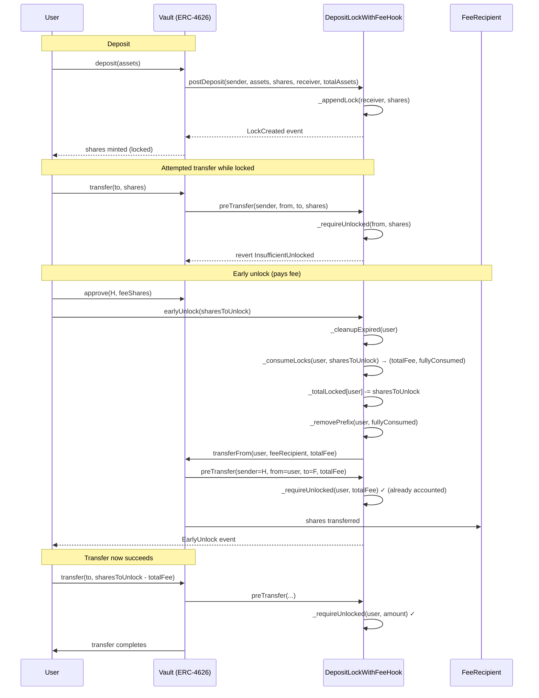

# Deposit Lock Hooks: Time-Locked Vault Shares

## 1. Summary

The Deposit Lock hook family time-locks vault shares minted via `deposit`/`mint`: locked shares cannot be transferred, withdrawn, or redeemed until each lock's `unlockTimestamp`. Shares remain in the user's wallet throughout; enforcement is purely accounting-based and happens through the vault's `IHook` extension points.

Two implementations are shipped:

| Hook | Extends | Added behaviour |
|---|---|---|
| `DepositLockHook` | `BaseOwnableHook` (`BaseHook` + OZ `Ownable`) | Base time-lock: `postDeposit`/`postMint` create locks; `preTransfer`/`preWithdraw`/`preRedeem` enforce them. Locks are consumed only by natural expiry. |
| `DepositLockWithFeeHook` | `DepositLockHook` | Optional early-exit path (`earlyUnlock`) that releases locked shares before expiry in exchange for a time-decaying fee paid in vault shares. |

> **Related: Reg S three-stage variant.** Share classes that need to enforce a Reg S restricted period in addition to a hard lock (transfer-blocked but redeem-allowed middle window) should use `DepositLockRegSHook` — a sibling contract with its own storage layout and asymmetric enforcement between transfer and redeem axes. It is **not** an extension of `DepositLockHook` and lives alongside it in `src/periphery/hooks/`. See [`DepositLockRegSHook.md`](./DepositLockRegSHook.md). Choose this family (`DepositLockHook` / `DepositLockWithFeeHook`) when a single unlock timestamp per lock suffices, and the Reg S variant when the transfer-vs-redeem unlock times must differ.

One hook deployment targets exactly one ERC-4626 vault (address supplied as a ClonesWithImmutableArgs immutable arg at clone time and exposed via `VAULT()`); the deploying factory is embedded alongside it and exposed via `FACTORY()`, gating `initialize(...)` to the factory.

---

## 2. Architectural Context

### 2.1 Wiring

The hook registers itself on the vault via the standard `IHook` interface. Two wiring modes are supported:

| Mode | `hookContainer` | Who may call mutating hook methods |
|---|---|---|
| Vault-only | `address(0)` (default) | The target vault only |
| Container | Non-zero | The target vault **or** the registered `HookContainer` |

The container is *fully trusted*: it can create locks and trigger enforcement paths with the same authority as the vault. It is set by the hook owner via `setHookContainer`.

### 2.2 IHook method usage

| Method | `DepositLockHook` | `DepositLockWithFeeHook` |
|---|---|---|
| `preDeposit` / `preMint` | no-op | no-op |
| `postDeposit` / `postMint` | `_appendLock(receiver, shares)` | inherited |
| `preTransfer` | `_requireUnlocked(from, shares)` | inherited |
| `postTransfer` | no-op | no-op |
| `preWithdraw` / `preRedeem` | `_requireUnlocked(owner, shares)` | inherited |
| `postWithdraw` / `postRedeem` | no-op | no-op |

Minimum-deposit / dust limits are explicitly **not** enforced here; they are expected to be implemented by the vault or by another hook.

---

## 3. `DepositLockHook`

### 3.1 Storage model

```solidity
struct Lock {
    uint128 shares;           // remaining locked shares in this entry
    uint64  unlockTimestamp;  // absolute release time
    uint64  duration;         // depositLockDuration snapshot at lock creation
}

mapping(address user => uint256 totalLocked) internal _totalLocked;
mapping(address user => Lock[] queue)        internal _locks;
```

| Parameter | Type | Notes |
|---|---|---|
| `depositLockDuration` | `uint64` | Seconds added to `block.timestamp` for new locks. `0` disables locking for new deposits (no lock created). |
| `maxLocksPerUser` | `uint256` | Cap on *active* (non-expired) lock entries per user. Default `10`. Must satisfy `0 < maxLocksPerUser ≤ MAX_LOCKS_PER_USER_CEILING (500)`; `setMaxLocksPerUser(0)` reverts with `ZeroMaxLocks` and values above the ceiling revert with `MaxLocksPerUserAboveCeiling` to keep all per-user O(N) paths well under the block gas limit. |
| `MAX_LOCKS_PER_USER_CEILING` | `uint256` (constant) | Hard upper bound on `maxLocksPerUser`. Set to `500`: the worst-case per-user O(N) paths (`_cleanupExpired`, `_removePrefix`, sorted-insert in `_appendLock`) measure under 1M gas at the ceiling (empirical, per-slot incremental ~1.9k gas), leaving a >30x margin against a 30M block gas limit, so a user can always exit their position in one transaction even if a third party fills all slots via on-behalf-of deposits. |
| `hookContainer` | `address` | See §2.1. |

`Lock.duration` is stored so that `DepositLockWithFeeHook` can compute per-lock linear fee decay without guessing the duration that applied when the lock was created.

### 3.2 Sorted insertion (non-decreasing `unlockTimestamp`)

`_appendLock` inserts each new lock so that `_locks[user]` is always sorted by `unlockTimestamp`:

```
if pending == 0 or unlockTs >= locks[pending-1].unlockTimestamp:
    push(newLock)                                   // O(1) fast path
else:
    push(newLock); shift right until sorted         // O(k) SSTOREs
```

- **Fast path** (new `unlockTs ≥ tail`): O(1) SSTOREs. This is the common case when `depositLockDuration` is unchanged or increased.
- **Shift path** (new `unlockTs < tail`): O(k) SSTOREs, where k is the number of entries that expire *after* the new lock. Bounded by `maxLocksPerUser`. This can only happen when `depositLockDuration` has been decreased since earlier deposits.

Sorted order enables:

- Prefix-removal in `_cleanupExpired` (no full scan needed).
- Early-break in view functions (`effectiveLockCount`, `_effectiveTotalLocked`, `previewEarlyUnlock`).
- Earliest-expiring-first consumption in `DepositLockWithFeeHook.earlyUnlock`.

### 3.3 Cleanup and compaction

`_cleanupExpired(user)` walks the sorted prefix of expired entries, subtracts their shares from `_totalLocked[user]`, shifts active entries to index 0, and pops excess slots (via `_removePrefix`).

```
Invariant POST _cleanupExpired:
    _locks[user].length  == number of active (non-expired) locks
    _totalLocked[user]   == sum of shares across all entries in _locks[user]
```

Between mutating calls, the invariants may temporarily be broken by expired entries that have not yet been cleaned. Every mutating path (`_appendLock`, `_requireUnlocked`, `earlyUnlock`) calls `_cleanupExpired` first to re-establish them.

### 3.4 `_totalLocked` invariant

`_totalLocked[user]` equals the sum of `shares` across all entries in `_locks[user]` **after** `_cleanupExpired` runs. It may overcount until cleanup. It is:

- **Incremented** only in `_appendLock` (lock creation).
- **Decremented** only in `_cleanupExpired` (natural expiry) and `earlyUnlock` (via `DepositLockWithFeeHook`).

No other code path may modify it. Any future extension that consumes locks must update `_totalLocked` in lockstep.

### 3.5 Lock creation flow (`_appendLock`)

```
Inputs: user, shares
  1. If shares == 0 or depositLockDuration == 0 → return (no lock)
  2. _cleanupExpired(user)
  3. require _locks[user].length < maxLocksPerUser           → MaxLocksExceeded
  4. require shares ≤ type(uint128).max                      → SharesOverflow
  5. rawUnlockTs = block.timestamp + depositLockDuration
  6. require rawUnlockTs ≤ type(uint64).max                  → UnlockTimestampOverflow
  7. Insert Lock(shares, unlockTs, duration) into _locks[user] at sorted position
  8. _totalLocked[user] += shares
  9. emit LockCreated(user, shares, unlockTs, duration)
```

### 3.6 Enforcement flow (`_requireUnlocked`)

```
Inputs: owner, shares
  1. If shares == 0 → return (no-op)
  2. _cleanupExpired(owner)
  3. unlocked = max(VAULT.balanceOf(owner) − _totalLocked[owner], 0)
  4. require shares ≤ unlocked                                → InsufficientUnlocked
```

`balanceOf − _totalLocked` is the user's currently-free share balance. Because expired locks have already been cleaned, the subtraction reflects reality.

### 3.7 View surface

**Stored (raw) views** — may include expired-but-not-yet-cleaned entries:

| Function | Returns |
|---|---|
| `storedTotalLocked(user)` | `_totalLocked[user]` (may overcount) |
| `storedLockCount(user)` | `_locks[user].length` (may include expired) |
| `getStoredLock(user, index)` | Raw `Lock` at `index` |

**Effective views** — simulate expiry in memory, no state writes:

| Function | Returns |
|---|---|
| `effectiveTotalLocked(user)` | Total locked after discounting expired locks |
| `effectiveLockCount(user)` | Active (non-expired) lock count |
| `getUnlockedShares(user)` | `max(balanceOf − effectiveTotalLocked, 0)` |

All effective views leverage the sorted-prefix property to early-break at the first non-expired entry.

### 3.8 Admin functions (owner-only)

| Function | Effect |
|---|---|
| `setDepositLockDuration(uint64)` | Applies to **new** deposits only; existing locks unchanged. Setting to `0` disables locking for new deposits without redeploying. |
| `setMaxLocksPerUser(uint256)` | Cap on active lock entries per user. Reverts with `ZeroMaxLocks` if `0` and with `MaxLocksPerUserAboveCeiling` if `> MAX_LOCKS_PER_USER_CEILING (500)`. |
| `setHookContainer(address)` | Add/remove the trusted `HookContainer` forwarder. |

### 3.9 Errors

| Error | Raised when |
|---|---|
| `OnlyVaultOrHookContainer()` | Non-authorised caller invokes a mutating hook method |
| `ZeroAddress()` | Constructor given `vault_ == address(0)` |
| `ZeroMaxLocks()` | `setMaxLocksPerUser` called with `0` |
| `MaxLocksPerUserAboveCeiling(requested, ceiling)` | `setMaxLocksPerUser` called with a value strictly greater than `MAX_LOCKS_PER_USER_CEILING` |
| `InsufficientUnlocked(owner, requested, unlocked)` | `_requireUnlocked` receives more shares than are free |
| `MaxLocksExceeded(user, current, maxLocks)` | `_appendLock` would exceed `maxLocksPerUser` |
| `UnlockTimestampOverflow()` | `block.timestamp + duration` exceeds `uint64.max` |
| `SharesOverflow()` | A single lock would exceed `uint128.max` shares |

### 3.10 Events

```solidity
event DepositLockDurationSet(uint64 previousDuration, uint64 newDuration);
event MaxLocksPerUserSet(uint256 previousMax, uint256 newMax);
event HookContainerSet(address previousContainer, address newContainer);
event LockCreated(address indexed user, uint256 shares, uint64 unlockTimestamp, uint64 duration);
```

---

## 4. `DepositLockWithFeeHook`

Extends `DepositLockHook` with an opt-in early-exit path. All §3 behaviour is preserved verbatim.

### 4.1 Fee model — linear decay per lock

```
fee_i = ⌈ consumed_i × maxEarlyUnlockFee × timeRemaining_i / (duration_i × FEE_BASIS) ⌉
```

where:

- `timeRemaining_i = max(unlockTimestamp_i − block.timestamp, 0)`
- `duration_i`     = snapshot stored in the lock
- `FEE_BASIS`      = `10_000` (basis points)
- `maxEarlyUnlockFee` ∈ `[0, FEE_BASIS]` (validated at setter and constructor)

Fee decays linearly with `timeRemaining`:

| Time of call | Fee rate (per lock) |
|---|---|
| At lock creation | `maxEarlyUnlockFee / FEE_BASIS` (max) |
| Halfway to expiry | `½ × maxEarlyUnlockFee / FEE_BASIS` |
| At expiry | `0` |

Ceiling rounding slightly favours the fee recipient.

### 4.2 Consumption order — earliest-expiring-first

`earlyUnlock` iterates `_locks[user]` front-to-back. Because the array is sorted by `unlockTimestamp`, this processes the earliest-expiring locks first. A lock may be partially consumed: its `shares` field is reduced in place. Fully consumed entries are batch-removed via `_removePrefix` after the loop.

**Fee-optimality caveat.** The strictly fee-optimal order is by fee rate (`timeRemaining / duration`) at call time, not by `unlockTimestamp`. These orders can diverge when `depositLockDuration` has been changed (locks with different `duration` values co-exist). Sorting by fee rate is impractical on-chain because the ranking changes every block; the current order is a cheap, deterministic heuristic that can be maintained at insertion time.

### 4.3 Minimum lock period (`minLockPeriod`)

`minLockPeriod` blocks early unlock during an initial window after lock creation. Creation time is derived on the fly as `unlockTimestamp − duration`.

```
eligibleAt = unlockTimestamp − duration + minLockPeriod
require block.timestamp ≥ eligibleAt  → LockWithinMinPeriod
```

Checked per-lock during consumption. If the *first* lock to be consumed is still within its min period, the call reverts before reaching later locks — even if those later locks are themselves eligible. Natural expiry is unaffected.

**Invariants on `minLockPeriod`:**

- Setter rejects `minLockPeriod ≥ depositLockDuration` (when both are non-zero).
- `setDepositLockDuration` also rejects a new duration that would break the above (when both non-zero).
- Either parameter may be set to `0` at any time without violating the invariant.

> Note: `minLockPeriod` is a global parameter applied at unlock time. If updated after locks already exist, older locks with shorter stored `duration` can become temporarily non-early-unlockable until their natural expiry.

### 4.4 `earlyUnlock` flow

```
Inputs: sharesToUnlock
Caller: user (msg.sender)

  1. require sharesToUnlock > 0                                → ZeroSharesRequested
  2. require earlyUnlockEnabled                                → EarlyUnlockDisabled
  3. If maxEarlyUnlockFee > 0:
        require feeRecipient != address(0)                     → NoFeeRecipient
  4. _cleanupExpired(user)
  5. require sharesToUnlock ≤ _totalLocked[user]               → InsufficientLockedShares
  6. (totalFee, fullyConsumed) = _consumeLocks(user, sharesToUnlock)
        - For each lock front-to-back:
            - Check minLockPeriod per-lock                     → LockWithinMinPeriod
            - Compute per-lock fee (ceiling rounding)
            - Reduce lock.shares in place (partial) or mark as fully consumed
  7. _totalLocked[user] −= sharesToUnlock
  8. If fullyConsumed > 0: _removePrefix(user, fullyConsumed)
  9. If totalFee > 0: VAULT.transferFrom(user, feeRecipient, totalFee)
 10. emit EarlyUnlock(user, sharesToUnlock, totalFee)
```

Key properties:

- **CEI ordering**: `_totalLocked` is reduced **before** the external `transferFrom` (step 7 vs step 9). This means the vault's `preTransfer` hook (which calls back into this contract) will see the updated free balance, so the fee transfer itself is always permitted.
- **Approval requirement**: the caller must pre-approve this contract for vault shares (ERC-20 `approve`). The transfer uses `SafeERC20.safeTransferFrom`.
- **Zero-fee fast path**: when `maxEarlyUnlockFee == 0` no transfer occurs; `feeRecipient` is not validated.

### 4.5 View function — `previewEarlyUnlock`

```solidity
function previewEarlyUnlock(address user, uint256 sharesToUnlock)
    external view returns (uint256 feeShares);
```

Read-only simulation of `earlyUnlock`. Reverts on the same conditions (`EarlyUnlockDisabled`, `NoFeeRecipient`, `InsufficientLockedShares`, `LockWithinMinPeriod`). Skips the expired prefix inline so it matches the post-cleanup state.

O(n) over the lock queue — **off-chain / UI use only**, not intended for on-chain state-changing callers.

### 4.6 Admin functions (owner-only)

| Function | Effect / guard |
|---|---|
| `setMaxEarlyUnlockFee(uint256)` | Rejects `newFee > FEE_BASIS`. |
| `setMinLockPeriod(uint64)` | Rejects `newPeriod ≥ depositLockDuration` when both non-zero. |
| `setDepositLockDuration(uint64)` | Overrides base: also rejects `minLockPeriod ≥ newDuration` when both non-zero. |
| `setFeeRecipient(address)` | Unrestricted (may be set to `address(0)` to disable early unlock when `maxEarlyUnlockFee > 0`). |
| `setEarlyUnlockEnabled(bool)` | Kill-switch for `earlyUnlock`. |

Inherited from base: `setMaxLocksPerUser`, `setHookContainer`.

### 4.7 Errors

Inherited: all §3.9 errors.

| Additional error | Raised when |
|---|---|
| `ZeroSharesRequested()` | `earlyUnlock(0)` |
| `NoFeeRecipient()` | `maxEarlyUnlockFee > 0` and `feeRecipient == address(0)` at call time |
| `EarlyUnlockDisabled()` | `earlyUnlock` or `previewEarlyUnlock` while disabled |
| `InsufficientLockedShares(user, requested, available)` | More shares requested than currently locked |
| `LockWithinMinPeriod(user, lockIndex, timeUntilEligible)` | Consumed lock is still within `minLockPeriod` (per-lock check) |
| `MaxFeeExceedsBasis(fee, basis)` | Constructor or setter given `fee > FEE_BASIS` |
| `MinLockPeriodExceedsDuration(minPeriod, duration)` | Constructor or setter would violate the `minLockPeriod < duration` invariant |

### 4.8 Events

Inherited: all §3.10 events.

```solidity
event EarlyUnlock(address indexed user, uint256 sharesUnlocked, uint256 feeShares);
event MaxEarlyUnlockFeeSet(uint256 previousFee, uint256 newFee);
event MinLockPeriodSet(uint64 previousPeriod, uint64 newPeriod);
event FeeRecipientSet(address previousRecipient, address newRecipient);
event EarlyUnlockEnabledSet(bool enabled);
```

---

## 5. Invariants

Across both hooks, the following must hold at the end of every transaction:

1. **Cleanup-post-condition**: after any call to `_cleanupExpired(user)`,
   - `_locks[user].length` equals the number of active (non-expired) locks;
   - `_totalLocked[user]` equals `Σ shares` across `_locks[user]`.
2. **Sorted order**: `_locks[user][i].unlockTimestamp ≤ _locks[user][i+1].unlockTimestamp` for all valid `i`.
3. **Bounded size**: `_locks[user].length ≤ maxLocksPerUser` (checked at insertion, not re-checked on lowering the cap). `maxLocksPerUser` is guaranteed to satisfy `0 < maxLocksPerUser ≤ MAX_LOCKS_PER_USER_CEILING` because `setMaxLocksPerUser` rejects both `0` and values above the ceiling. The ceiling guarantees every per-user O(N) path (cleanup, removal, sorted-insert) fits in a single transaction with a comfortable margin on every supported chain.
4. **Enforcement**: at every `preTransfer` / `preWithdraw` / `preRedeem` call with a non-zero amount, the transferred/withdrawn amount does not exceed the user's free balance (`balanceOf − effectiveTotalLocked`).
5. **Fee model bounds**: for any single `earlyUnlock` call, `totalFee ≤ sharesToUnlock × maxEarlyUnlockFee / FEE_BASIS`. This is checked by the fuzz test `testFuzz_earlyUnlock_feeNeverExceedsMaxPercentage`.
6. **Fee monotonicity**: for a single lock held across two calls at `t1 < t2 ≤ unlockTimestamp`, the per-share fee at `t2` ≤ per-share fee at `t1`. Checked by `testFuzz_earlyUnlock_feeDecreasesOverTime`.

---

## 6. Access Control

| Function | Caller |
|---|---|
| `postDeposit`, `postMint`, `preTransfer`, `preWithdraw`, `preRedeem` | Target vault or registered `hookContainer` only |
| `earlyUnlock` | Permissionless (`msg.sender == user`) |
| `setDepositLockDuration`, `setMaxLocksPerUser`, `setHookContainer`, `setMaxEarlyUnlockFee`, `setMinLockPeriod`, `setFeeRecipient`, `setEarlyUnlockEnabled` | Owner (OZ `Ownable`) |

---

## 7. Edge Cases and Configuration Notes

- **`depositLockDuration == 0`**: `_appendLock` returns early; no lock is created. Canonical way to disable locking for new deposits without redeploying.
- **`shares == 0`** in `postDeposit` / `postMint`: `_appendLock` returns early; no state change, no event.
- **`shares == 0`** in `preTransfer` / `preWithdraw` / `preRedeem`: `_requireUnlocked` returns early; no revert.
- **Fee recipient transfer self-loop**: if `feeRecipient == user`, the fee transfer is a self-transfer; locks from the fee side are not re-created because `feeRecipient` receives *already-unlocked* shares (the shares were unlocked in step 7 before the transfer).
- **`maxEarlyUnlockFee == 0`**: `earlyUnlock` works as a free exit path; `feeRecipient` not validated.
- **`feeRecipient == address(0)` with `maxEarlyUnlockFee > 0`**: `earlyUnlock` reverts with `NoFeeRecipient`. Disables early unlock.
- **`earlyUnlockEnabled == false`**: `earlyUnlock` and `previewEarlyUnlock` revert with `EarlyUnlockDisabled`. Kill-switch independent of fee config.
- **Duration decrease with pre-existing locks**: new locks are inserted at their sorted position, potentially shifting earlier locks rightward. Test coverage: `test_durationDecrease_shortLockExpiresBeforeLongLock`, `test_durationDecrease_multipleOutOfOrderLocks`, `testFuzz_durationDecrease_compactionPreservesInvariant`.
- **Overflow bounds**: per-lock shares limited to `uint128.max`; `unlockTimestamp` limited to `uint64.max`. Both validated explicitly at insertion.

---

## 8. Known Limitations

- **O(n) sorted insertion** when `depositLockDuration` is reduced and a new lock expires earlier than existing ones. Bounded by `maxLocksPerUser`.
- **Not ordered by creation time**: locks are ordered by `unlockTimestamp`, not by deposit chronology. Consumers that assume creation-time ordering may see unexpected results after a `depositLockDuration` decrease.
- **Cleanup dependency**: `_cleanupExpired` must run before any mutating operation that reads `_totalLocked` or iterates `_locks`. All internal paths comply; future extensions must preserve this.
- **Hook container trust**: when set, `hookContainer` has the same authority as the vault. Swapping containers requires the owner to trust the new forwarder preserves the same call semantics.
- **`previewEarlyUnlock` gas cost** scales with the number of locks and is not intended for on-chain consumption.

---

## 9. Numeric Example — early unlock with linear decay

```
Setup:
    depositLockDuration = 30 days
    maxEarlyUnlockFee   = 500 bp   (5%)
    minLockPeriod       = 0
    Alice deposits at t=0:
        500 shares locked → unlockTimestamp = 30 days, duration = 30 days

Scenario A — t = 0 (at creation)
    timeRemaining = 30 days
    fee = ⌈ 500 × 500 × 30d / (30d × 10 000) ⌉ = 25 shares   (5%)

Scenario B — t = 15 days (halfway)
    timeRemaining = 15 days
    fee = ⌈ 500 × 500 × 15d / (30d × 10 000) ⌉ = 13 shares   (~2.5%, +1 ceiling)

Scenario C — t = 30 days (at expiry)
    timeRemaining = 0
    fee = 0

Scenario D — partial consumption, two locks
    Alice also has a second lock: 200 shares, unlockTimestamp = 20 days, duration = 20 days
    Queue (sorted by unlockTimestamp):
        locks[0] = (200, 20d, 20d)   ← consumed first
        locks[1] = (500, 30d, 30d)

    Call at t=10 days: earlyUnlock(300)
        Lock 0:  consume 200, timeRemaining = 10d, duration = 20d
            fee₀ = ⌈ 200 × 500 × 10d / (20d × 10 000) ⌉ = 5 shares
        Lock 1:  consume 100, timeRemaining = 20d, duration = 30d
            fee₁ = ⌈ 100 × 500 × 20d / (30d × 10 000) ⌉ ≈ 4 shares (ceiling)
        totalFee = 9 shares, fullyConsumed = 1
        _totalLocked[Alice]:  700 → 400
        Queue after: locks[0] = (400, 30d, 30d)
```

---

## 10. Interaction Sequence (deposit, lock, early unlock)



---

## 11. Test Coverage Reference

| Area | Unit test file |
|---|---|
| Base lock semantics, sorted insertion, cleanup, admin guards, overflow | `test/periphery/unit-test/DepositLockHook.t.sol` |
| Fee decay, min lock period, partial consumption, `earlyUnlock` revert paths, `previewEarlyUnlock` parity, fuzz invariants | `test/periphery/unit-test/DepositLockWithFeeHook.t.sol` |

Key invariant / fuzz tests:

- `test_invariant_totalLockedNeverExceedsBalance`
- `testFuzz_compaction_preservesInvariant`
- `testFuzz_durationDecrease_compactionPreservesInvariant`
- `testFuzz_earlyUnlock_feeNeverExceedsMaxPercentage`
- `testFuzz_earlyUnlock_feeDecreasesOverTime`
