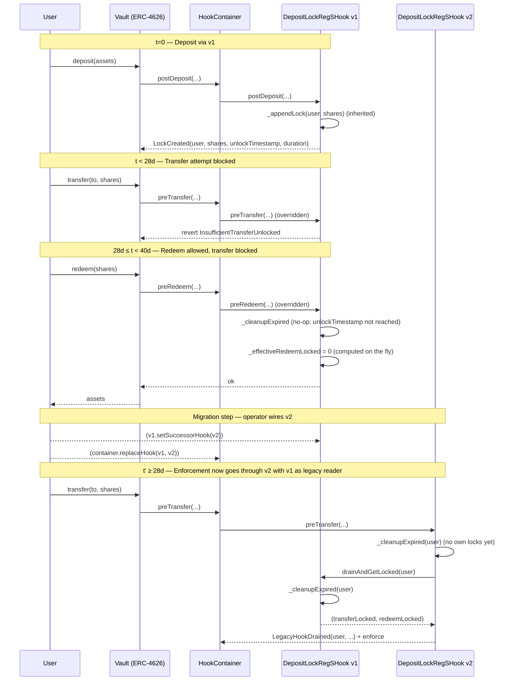

# `DepositLockRegSHook`: Reg S Three-Stage Share Lock

## 1. Summary

`DepositLockRegSHook` is an inheritance-based extension of [`DepositLockHook`](./DepositLockHooks.md) that adds a **three-stage lifecycle** for share classes that need to enforce a Reg S restricted period in addition to a hard lock. The three states for every individual lock are:

| Window | Transfer | Redeem / Withdraw | Notes |
|---|---|---|---|
| `[0, hardLockDuration)` — **Hard lock** | blocked | blocked | Full lock after deposit. |
| `[hardLockDuration, hardLockDuration + regSExtension)` — **Reg S** | blocked | allowed | Only share transfers are restricted. Redeem yields the underlying asset at the vault's next async epoch. The asset received from redemption is not restricted. |
| `[hardLockDuration + regSExtension, ∞)` — **Unlocked** | allowed | allowed | Shares are fully free. |

Locks are created per deposit/mint and accumulate per user (same as `DepositLockHook`). Shares stay in the user's wallet at all times — enforcement is accounting-based via the standard `IHook` extension points.

One hook deployment targets exactly one ERC-4626 vault (address supplied as a ClonesWithImmutableArgs immutable arg at clone time and exposed via `VAULT()`, inherited from `BaseHook`); the deploying factory is embedded alongside it and exposed via `FACTORY()`.

---

## 2. Inheritance and Relationship to `DepositLockHook`

`DepositLockRegSHook is DepositLockHook, IDepositLockRegSHook`. The Reg-S derivative reuses the base **verbatim** for the queue/cleanup machinery and layers the second enforcement axis (redeem) plus the migration primitive on top.

### 2.1 What is inherited verbatim

| From the base | Used as-is for |
|---|---|
| `struct Lock { uint128 shares; uint64 unlockTimestamp; uint64 duration; }` | Per-lock record. `unlockTimestamp` is the **transfer** unlock instant in Reg-S terms. |
| `mapping(address => Lock[]) _locks` | Sorted queue of lock records. |
| `mapping(address => uint256) _totalLocked` | Cached transfer-locked aggregate. Reg-S exposes it via `storedTransferLocked(user)` and feeds it from `_effectiveTotalLocked` for the effective view. |
| `_appendLock`, `_cleanupExpired`, `_removePrefix`, `_effectiveTotalLocked`, `_requireUnlocked` | Sorted insertion, prefix-removal cleanup, effective view, and base transfer-axis enforcement (used internally by `_requireTransferUnlocked`). |
| Modifier `onlyVaultOrHookContainer` | Mutating-hook access control. |
| Common errors: `OnlyVaultOrHookContainer`, `ZeroAddress`, `ZeroMaxLocks`, `MaxLocksPerUserAboveCeiling`, `MaxLocksExceeded`, `UnlockTimestampOverflow`, `SharesOverflow` | Same selectors are raised by inherited paths. Tests reference them as `DepositLockHook.<Error>.selector`. |
| Common events: `LockCreated(user, shares, unlockTimestamp, duration)`, `MaxLocksPerUserSet`, `HookContainerSet`, `DepositLockDurationSet` | Same selectors emitted by inherited paths. |
| Constants & params: `MAX_LOCKS_PER_USER_CEILING (500)`, `maxLocksPerUser`, `hookContainer`, `setMaxLocksPerUser`, `setHookContainer` | Same admin surface as the base. |

### 2.2 What the derivative adds

| New piece | Role |
|---|---|
| `REG_S_EXTENSION` (`uint64`, immutable) | Reg S extension added on top of `hardLockDuration`. |
| `hardLockDuration()` view + `setHardLockDuration(uint64)` setter | Reg-S-canonical hard-lock parameter. Setter validates `> 0` and maintains the invariant `depositLockDuration == hardLockDuration + REG_S_EXTENSION`. |
| `legacyHook` (`IDepositLockRegSHook`, settable at construction time, owner-disconnectable via `disconnectLegacyHook`) + `successorHook` (mutable) | Migration coupling for v1 ↔ v2 hooks (§6). |
| `disconnectLegacyHook()` | Owner-only, downgrade-only setter that clears `legacyHook` to `address(0)` after v1 has fully drained. See §6.4. |
| `drainAndGetLocked(address, uint256)` | Migration primitive: cleanup + optional Reg-S consume + aggregates. Gated by `onlySuccessorHook`. |
| `preTransfer`/`preWithdraw`/`preRedeem` overrides | Add the legacy-drain contribution and dispatch to the per-axis require. |
| `_requireTransferUnlocked`, `_enforceRedeemAndConsumeTransferLock` | Two-axis enforcement; redeem path uses `_activeLockSegments` + `_consumeRegSRange`. |
| `_activeLockSegments`, `_consumeRegSRange` | Reg-S prefix `[0, regSEnd)` vs hard-lock suffix; FIFO consume of transfer locks on redeem/withdraw (and via `drainAndGetLocked`). |
| `_effectiveRedeemLocked(address)` (internal view) | Delegates to `_activeLockSegments`; sums hard-lock suffix shares. |
| Views: `effectiveTransferLocked`, `effectiveRedeemLocked`, `storedTransferLocked`, `getStoredLockRedeemUnlockTimestamp`, `getUnlockedTransferShares`, `getUnlockedRedeemShares`, `legacyContribution` | Reg-S-canonical view surface. |
| Errors: `OnlySuccessorHook`, `ZeroHardLockDuration`, `InsufficientTransferUnlocked`, `InsufficientRedeemUnlocked`, `LegacyHookVaultMismatch`, `UseSetHardLockDuration`, `NoLegacyToDisconnect` | Reg-S-specific failure modes. |
| Events: `HardLockDurationSet`, `SuccessorHookSet`, `LegacyHookDrained`, `LegacyHookDisconnected` | Reg-S-canonical events. |

### 2.3 What the derivative closes

- **`setDepositLockDuration(uint64)`** is overridden to **always revert** with `UseSetHardLockDuration`. The Reg-S derivative manages the underlying `depositLockDuration` slot exclusively through `setHardLockDuration` so the invariant `depositLockDuration == hardLockDuration + REG_S_EXTENSION` cannot be silently broken. The `onlyOwner` modifier is intentionally dropped on the override so non-owner callers receive the informative revert reason instead of an access-control error.

### 2.4 Encoding the two unlock instants in one slot

The base contract stores a single `uint64 unlockTimestamp` per lock. The Reg-S derivative reuses that slot for the **transfer** unlock instant (the latest of the two unlocks) by initialising the base's `depositLockDuration` with `hardLockDuration + REG_S_EXTENSION`. The implicit redeem-unlock instant is derived on demand:

```
redeemUnlockTimestamp_i = unlockTimestamp_i − REG_S_EXTENSION
```

`REG_S_EXTENSION` being immutable guarantees this derivation is well defined uniformly across the queue, and that sorting by `unlockTimestamp` (maintained by the inherited `_appendLock`) is equivalent to sorting by the implicit `redeemUnlockTimestamp`. Off-chain consumers can read the derived value via the helper `getStoredLockRedeemUnlockTimestamp(user, index)`.

### 2.5 Inherited side-effects worth noting

These are cosmetic consequences of inheriting from a contract whose surface was authored for the single-axis case. None of them affect on-chain enforcement semantics.

- **`DepositLockDurationSet(0, hard + REG_S_EXTENSION)`** is emitted by the base constructor. In Reg-S terms the value is the **transfer** unlock total, not the hard lock. The derivative additionally emits `HardLockDurationSet(0, hardLockDuration)` so Reg-S indexers can consume a canonical event.
- **`LockCreated(user, shares, unlockTimestamp, duration)`** (the base event) does not include `redeemUnlockTimestamp` explicitly. Indexers derive it as `unlockTimestamp − REG_S_EXTENSION` (the extension is queryable from the public immutable getter).
- **`depositLockDuration()`** (inherited getter) returns `hardLockDuration + REG_S_EXTENSION`. Use `hardLockDuration()` for the Reg-S-canonical value.
- **`setDepositLockDuration(uint64)`** stays in the ABI but always reverts (see §2.3).

---

## 3. Wiring & IHook usage

### 3.1 Wiring

Same `IHook` interface as the rest of the lock-hook family. Two wiring modes (inherited from the base):

| Mode | `hookContainer` | Who may call mutating hook methods |
|---|---|---|
| Vault-only | `address(0)` (default) | The target vault only |
| Container | Non-zero | The target vault **or** the registered `HookContainer` |

The container is fully trusted; it can create locks and trigger enforcement paths with the same authority as the vault.

### 3.2 IHook method behaviour

| Method | Source | Behaviour |
|---|---|---|
| `preDeposit` / `preMint` | inherited (`DepositLockHook`) | no-op |
| `postDeposit` / `postMint` | inherited | `_appendLock(receiver, shares)` (sorted insertion by `unlockTimestamp = creationTime + hardLockDuration + REG_S_EXTENSION`) |
| `preTransfer` | **overridden** | `_requireTransferUnlocked(from, shares)` (own `_totalLocked` + optional `legacyHook.drainAndGetLocked` contribution) |
| `postTransfer` | inherited | no-op |
| `preWithdraw` / `preRedeem` | **overridden** | `_enforceRedeemAndConsumeTransferLock` (cleanup + legacy drain, redeem check, `lockBurn` consume on Reg-S prefix via `_consumeRegSRange`) |
| `postWithdraw` / `postRedeem` | inherited | no-op |

Minimum-deposit / dust limits are explicitly **not** enforced here.

---

## 4. Data Model and Storage

### 4.1 Lock record (inherited, single storage slot)

```solidity
struct Lock {              // declared in DepositLockHook, reused here
    uint128 shares;
    uint64  unlockTimestamp;   // = creationTime + hardLockDuration + REG_S_EXTENSION (the *transfer* unlock instant in Reg-S)
    uint64  duration;          // = hardLockDuration + REG_S_EXTENSION snapshot at creation
}
```

The struct packs into a single 32-byte slot. **Only the *transfer* unlock instant is stored** — it is always the maximum of the two unlock instants because `unlockTimestamp = redeemUnlockTimestamp + REG_S_EXTENSION` with `REG_S_EXTENSION ≥ 0`. The implicit `redeemUnlockTimestamp` is derived on demand.

`duration` is reused from the base as a snapshot of the *total* lock duration at creation time, kept for forward-compatibility with possible extensions (e.g. a Reg S analogue of `DepositLockWithFeeHook`'s linear-decay fee).

### 4.2 Per-user state (inherited)

```solidity
mapping(address user => uint256 totalLocked) internal _totalLocked;   // == transfer-locked aggregate in Reg-S
mapping(address user => Lock[]  queue)       internal _locks;
```

Exactly the same shape as `DepositLockHook`: a single cached aggregate plus the sorted queue. **There is no `_redeemLocked` mapping** — the redeem-locked total is recomputed on demand from the queue (see `_effectiveRedeemLocked`, §5.3).

Post-cleanup invariant for every user `u` (inherited from the base):

```
_totalLocked[u] = Σ lock.shares for locks in _locks[u]
                = Σ lock.shares for locks with unlockTimestamp > now (after cleanup)
```

Between mutating calls the aggregate may overcount (transfer-expired entries that have not yet been cleaned are still summed in). Every mutating path calls `_cleanupExpired` first to restore the invariant.

The implicit redeem-locked aggregate satisfies, at all times,

```
effectiveRedeemLocked(u) ≤ effectiveTransferLocked(u)
```

because every lock that contributes to the redeem-locked sum (i.e. has `unlockTimestamp − REG_S_EXTENSION > now`) also has `unlockTimestamp > now` and therefore contributes to the transfer-locked sum as well.

### 4.3 Configuration parameters

| Parameter | Type | Mutability | Notes |
|---|---|---|---|
| `REG_S_EXTENSION` | `uint64` | **Immutable** (constructor) | Seconds. Added on top of `hardLockDuration` to derive each lock's `unlockTimestamp`. Immutable so that every lock's implicit `redeemUnlockTimestamp` is well defined uniformly across the queue. Changing the Reg S window requires deploying a new hook and following the migration procedure (§6). |
| `hardLockDuration()` | `uint64` (view) | Owner-mutable via `setHardLockDuration` | Seconds. Must be strictly positive (constructor and setter reject `0`). Setter also reverts if `hardLockDuration + REG_S_EXTENSION` overflows `uint64`. Changes apply only to new deposits. |
| `maxLocksPerUser` | `uint256` | Owner-mutable (inherited) | Cap on stored lock entries per user. Default `10`. Must satisfy `0 < maxLocksPerUser ≤ MAX_LOCKS_PER_USER_CEILING (500)`. |
| `MAX_LOCKS_PER_USER_CEILING` | `uint256` (constant, inherited) | `500` | Keeps every per-user O(N) path (cleanup, sorted insertion, redeem-locked walk) under the block gas limit with a comfortable margin. |
| `hookContainer` | `address` | Owner-mutable (inherited) | See §3.1. |
| `successorHook` | `address` | Owner-mutable | See §6. Defaults to `address(0)` (drain disabled). |
| `legacyHook` | `address` | **Set at construction time, owner-disconnectable** | See §6. Defaults to `address(0)` (first deployment for the vault). Constructor validates `legacyHook.vault() == vault_`. The owner can call `disconnectLegacyHook()` to permanently clear the slot to `address(0)`; the transition is one-way (no re-population path). |

---

## 5. Queue Ordering, Cleanup, and Redeem Computation

### 5.1 Sorted by `unlockTimestamp` ⇔ sorted by implicit `redeemUnlockTimestamp`

`_appendLock` (inherited) keeps `_locks[user]` sorted by non-decreasing `unlockTimestamp`. Because `REG_S_EXTENSION` is immutable, every lock has

```
unlockTimestamp_i − redeemUnlockTimestamp_i = REG_S_EXTENSION   (constant)
```

so sorting by `unlockTimestamp` is equivalent to sorting by the implicit `redeemUnlockTimestamp`. Two consequences:

1. The fully-expired entries (`unlockTimestamp ≤ now`) form a contiguous **prefix** of the queue and are removed by `_cleanupExpired`.
2. The still-redeem-locked entries (`unlockTimestamp − REG_S_EXTENSION > now`) form a contiguous **suffix** of the queue and can be summed by a single break-early forward walk.

### 5.2 `_cleanupExpired` and `_appendLock` — inherited unchanged

The base's pseudocode applies verbatim:

```
i = 0
while i < len and now ≥ locks[i].unlockTimestamp:
    _totalLocked[user] -= locks[i].shares
    i++
firstActive = i

if firstActive > 0:
    _removePrefix(user, firstActive)
```

A lock entry stays in the queue **until its `unlockTimestamp` (the transfer-unlock instant in Reg-S) is reached**, even after it has crossed the middle Reg S window. There is no sentinel marker and no extra cleanup phase for the redeem axis — the redeem-locked aggregate is recomputed on demand by `_effectiveRedeemLocked` (§5.3).

`_appendLock`'s sorted insertion is also identical: fast path is O(1) when the new lock expires at or after the tail; otherwise a backwards shift of length at most `pending`, bounded by `maxLocksPerUser`.

### 5.3 `_effectiveRedeemLocked` — computed on the fly

```
sum = 0
for i in 0..len:
    redeemTs = locks[i].unlockTimestamp − REG_S_EXTENSION
    if redeemTs > now:
        # sorted ⇒ from here on every entry is also redeem-locked
        while i < len:
            sum += locks[i].shares
            i++
        return sum
return 0
```

Cost: O(active entries) reads, no writes. Short-circuits once the suffix of redeem-locked entries is reached. Bounded by `maxLocksPerUser` (default 10, ceiling 500).

The subtraction never underflows: by construction `unlockTimestamp ≥ creationTime + hardLockDuration + REG_S_EXTENSION ≥ REG_S_EXTENSION + 1` for any created lock (the constructor + setter guarantee `hardLockDuration > 0`).

### 5.4 Why on-the-fly instead of caching

Caching a `_redeemLocked` aggregate would require mutating storage at *two* different moments in a lock's lifecycle: at creation (to add) and at the middle-window crossing (to subtract). The middle-window crossing has no natural trigger — it has to be detected during cleanup using a sentinel marker. That marker in turn requires extra storage in the `Lock` struct, an extra `SSTORE` per crossing, and additional cleanup logic to avoid double-subtracting.

By recomputing on demand we trade ≤ `maxLocksPerUser` reads on each redeem/withdraw for:

- one less storage slot per lock (cuts the struct from 2 slots to 1, matching the base exactly so inheritance is layout-safe),
- no per-entry sentinel `SSTORE`,
- a `_cleanupExpired` that is structurally identical to the base's (auditable by analogy),
- no extra cached aggregate to keep in sync.

The total enforcement cost is dominated by `_cleanupExpired` either way; the on-the-fly walk adds only a small constant factor in the worst case.

---

## 6. Migration — `successorHook` / `legacyHook` Pattern

The hook supports forward-compatible migration without ever running two enforcement hooks simultaneously inside the same `HookContainer`. The migration mechanic is built around a coupled pair of fields:

- **v1 — `successorHook`** (owner-settable, mutable): identifies the future v2 hook authorized to drain v1.
- **v2 — `legacyHook`** (set in v2's constructor, owner-disconnectable via `disconnectLegacyHook`): identifies the predecessor v1 hook v2 reads from. The slot is **monotonically downgradeable** — the constructor writes it once and the only post-deploy write path moves it to `address(0)`. There is no re-population path.

### 6.1 The drain primitive

```solidity
function drainAndGetLocked(address user, uint256 regSSharesToConsume)
    external
    onlySuccessorHook
    returns (uint256 transferLocked, uint256 redeemLocked, uint256 regSConsumed);
```

- **Access control.** `onlySuccessorHook` reverts with `OnlySuccessorHook` if `msg.sender != successorHook` or `successorHook == address(0)`.
- **Body.** Runs `_cleanupExpired(user)`. When `regSSharesToConsume > 0`, also runs `_consumeRegSRange` on this hook's Reg-S middle-window block (FIFO) so predecessor locks track shares burned via redeem/withdraw on the successor. Returns post-update `(_totalLocked[user], _effectiveRedeemLocked(user), regSConsumed)`. Pass `regSSharesToConsume = 0` on transfer-only drains.
- **Idempotency.** Repeat calls only iterate over locks created since the previous invocation; once every lock at the time of migration has fully expired (`hardLockDuration + REG_S_EXTENSION` after the last deposit handled by v1), the returned tuple is `(0, 0)` in ≈ O(1) gas.
- **Single hop only.** `drainAndGetLocked` and `legacyContribution` consult **only** the direct `legacyHook` slot on this deployment. They do **not** recurse into `legacyHook.legacyHook()`. Correctness across v1 → v2 → v3 migrations depends on the operational protocol in §6.5: the immediate predecessor must be **empty** (lock period elapsed) and **disconnected** before the next hook is deployed.

### 6.2 Enforcement coupling in v2

```solidity
function _requireTransferUnlocked(address user, uint256 shares) internal {
    if (shares == 0) return;
    _cleanupExpired(user);

    uint256 locked = _totalLocked[user];
    IDepositLockRegSHook legacy = legacyHook;
    if (address(legacy) != address(0)) {
        (uint256 legacyTransfer, uint256 legacyRedeem,) = legacy.drainAndGetLocked(user, 0);
        emit LegacyHookDrained(user, legacyTransfer, legacyRedeem);
        locked += legacyTransfer;
    }

    uint256 balance = VAULT.balanceOf(user);
    uint256 unlocked = balance > locked ? balance - locked : 0;
    if (shares > unlocked) revert InsufficientTransferUnlocked(user, shares, unlocked);
}
```

The redeem path calls `legacy.drainAndGetLocked(user, 0)` before the unlock check, then computes how much of the burn should reduce transfer locks:

```
transferLocked = _totalLocked[user] + legacyTransfer
transferFree   = max(balance − transferLocked, 0)
lockBurn       = max(0, shares − transferFree)    // transfer-unlocked shares burned first
```

If `lockBurn == 0`, no Reg-S consume runs. Otherwise `legacy.drainAndGetLocked(user, min(lockBurn, legacyTransfer))` runs first (FIFO on the predecessor), then `_consumeRegSRange(user, regSEnd, lockBurn − legacyConsumed)` on the successor. This prevents over-consuming Reg-S locks when the redeem burns shares that were never transfer-locked (e.g. received via transfer).

**Why not run v1 and v2 simultaneously inside the container.** Each hook computes `balanceOf(user) − own_locked(user)` independently. If both hooks enforced in parallel, each would see the other's locks as "free balance" and the combined enforcement would systematically under-count locks. The legacy reader pattern avoids this by making v2 the single source of enforcement, with v1 contributing only a residual aggregate that v2 adds to its own.

### 6.3 Operational runbook (single migration: v1 → v2)

1. **Deploy v2.** Pass `legacyHook = address(v1)` and the desired (new) `regSExtension`/`hardLockDuration`. v2's constructor verifies `v1.vault() == v2.vault()`.
2. **Authorise v2 on v1.** Call `v1.setSuccessorHook(address(v2))`. This is the **only** address from which v1 will accept `drainAndGetLocked` calls.
3. **Swap enforcement.** In the vault's `HookContainer`, call `replaceHook(v1, v2)` (see §7). The swap is atomic: there is no intermediate block during which the container has no lock hook registered.
4. **Drain monitoring.** Index `LegacyHookDrained` events emitted by v2 (and/or off-chain enumerate active v1 users via prior `LockCreated` events). Once every user with v1 residual locks has interacted via v2 at least once after `hardLockDuration_v1 + regSExtension_v1`, v1 is fully drained for them. A safe upper bound for the operator is *(timestamp of the v1 `replaceHook` swap) + `hardLockDuration_v1 + regSExtension_v1`* — no v1 lock can outlive that instant, because v1 stops creating locks once it leaves the container.
5. **(Optional) clear successor.** After full drain, call `v1.setSuccessorHook(address(0))` to disable the drain entrypoint.
6. **Disconnect the legacy reference on v2** (see §6.4). This is the recommended steady-state once v1 is provably drained.

### 6.4 `disconnectLegacyHook` — permanent downgrade of the legacy reference

```solidity
function disconnectLegacyHook() external onlyOwner;
```

- **Effect.** Writes `address(0)` to the `legacyHook` slot and emits `LegacyHookDisconnected(previousLegacyHook)`. From this point onwards, every enforcement call (`preTransfer` / `preWithdraw` / `preRedeem`) and every read path (`getUnlockedTransferShares`, `getUnlockedRedeemShares`, `legacyContribution`) skips the external call to v1 and treats the legacy contribution as zero.
- **Reverts.** With `NoLegacyToDisconnect` when the slot already holds `address(0)` — either the deployment was constructed without a legacy or a previous `disconnectLegacyHook` already cleared it.
- **One-way.** The slot is monotonically downgradeable. There is no setter to re-populate it; the only authority over `legacyHook` is "the constructor wrote it" or "the owner cleared it once".
- **Power surface.** The owner cannot redirect the legacy slot to a different address. The maximum effect of an owner-induced disconnect is to skip enforcement of v1's residual locks. The change is permanent and explicitly logged (`LegacyHookDisconnected`).
- **When to call.** Strictly after every v1 lock has fully expired — i.e. *(timestamp of the `replaceHook` swap on v1) + `hardLockDuration_v1 + regSExtension_v1`*. Disconnecting earlier silently frees any residual v1 locks for transfer / redeem on v2.

The motivating gains, once disconnected:

- One external call (`drainAndGetLocked`) is removed from every enforcement path. The saving dominates the warm `SLOAD` cost of reading the now-mutable `legacyHook` slot in the common no-legacy path.
- The vault's enforcement stack no longer depends on v1 being callable. If v1 ever becomes inoperable for any reason (e.g. its code is selfdestructed in an unrelated incident), enforcement on v2 continues unaffected.
- Subsequent migrations cascade safely (§6.5).

### 6.5 Multi-step migration (v2 → v3 after a previous v1 → v2)

**Prerequisite before every new hook deployment:** the `DepositLockRegSHook` that will become `legacyHook` must already be **vacío** — no residual transfer/redeem locks for any user. Concretely:

1. **Time:** at least `hardLockDuration + REG_S_EXTENSION` must have passed since that hook was removed from the `HookContainer` (`replaceHook`), so every lock it ever created has reached `unlockTimestamp` (the transfer-unlock instant). No new deposits can be made on that hook after it leaves the container.
2. **Drain / verify:** for each affected user, `legacyContribution(user)` on the *successor still wired to that predecessor* should read `(0, 0)`, or off-chain indexers should confirm no active `LockCreated` entries remain unexpired.
3. **Disconnect:** the owner calls `disconnectLegacyHook()` on the hook that pointed at the drained predecessor (e.g. v2 disconnects v1). After this, `v2.legacyHook() == address(0)`.

Only then deploy the next hook (v3 with `legacyHook = address(v2)`). **Do not** deploy v3 while `v2.legacyHook` still points at v1: v3 would only see v2's local storage via `drainAndGetLocked`, and **v1 residual locks would not be enforced** — a silent under-count (the nested-legacy audit finding).

Runbook for v1 → v2 → v3:

1. Complete v1 → v2 (§6.3), including `v2.disconnectLegacyHook()` after step 1's time bound for v1.
2. Deploy v3 with `legacyHook = address(v2)`; `v2.setSuccessorHook(v3)`; `replaceHook(v2, v3)`.
3. After v2's own lock period has elapsed for all v2-created locks, `v3.disconnectLegacyHook()`.

**Operational invariant:** for every active deployment vN, `vN.legacyHook` is either the immediate predecessor vN-1 **with vN-1 already empty and about to be disconnected**, or `address(0)` once vN-1 is disconnected. Older hooks (vN-2, …) must never remain linked under vN-1 when vN is wired.

Skipping the wait in step 1 before `disconnectLegacyHook` silently frees residual predecessor locks on the successor. Wiring v3 while `v2.legacyHook == v1` omits v1 from v3 enforcement entirely.

---

## 7. `HookContainer.replaceHook` — Atomic Swap

`HookContainer` gains a single admin method:

```solidity
function replaceHook(address oldHook, address newHook)
    external
    onlyRole(HOOK_MANAGER_ROLE);
```

Semantically equivalent to `removeHook(oldHook) + addHook(newHook)` but performed in a single transaction so that the container's hook set is never empty between the two operations. The new hook is installed at the same slot as the old hook to keep call ordering stable for callers that rely on it.

Validations mirror `addHook`:

| Validation | Error |
|---|---|
| `newHook != address(0)` | `ZeroAddress` |
| `newHook != address(this)` | `SelfRegistrationNotAllowed` |
| `oldHook != newHook` | `HookReplacementIdentical` |
| `oldHook` is registered | `HookNotRegistered` |
| `newHook` is **not** already registered | `HookAlreadyRegistered` |
| `newHook.vault() == VAULT` | `HookVaultMismatch` |

Emits `HookReplaced(oldHook, newHook)`.

---

## 8. Errors, Events, and Admin Surface

### 8.1 Errors

| Error | Origin | Raised when |
|---|---|---|
| `OnlyVaultOrHookContainer()` | inherited | Non-authorised caller invokes a mutating `IHook` method. |
| `ZeroAddress()` | inherited | Constructor given `vault_ == address(0)`. |
| `ZeroMaxLocks()` | inherited | `setMaxLocksPerUser(0)`. |
| `MaxLocksPerUserAboveCeiling(requested, ceiling)` | inherited | `setMaxLocksPerUser` above the ceiling. |
| `MaxLocksExceeded(user, current, maxLocks)` | inherited | `_appendLock` would exceed `maxLocksPerUser`. |
| `UnlockTimestampOverflow()` | inherited | `block.timestamp + (hardLockDuration + REG_S_EXTENSION)` exceeds `uint64.max` at insertion. |
| `SharesOverflow()` | inherited | A single lock would exceed `uint128.max` shares. |
| `OnlySuccessorHook()` | Reg-S | `drainAndGetLocked` called by an account other than the registered `successorHook`, or when `successorHook == address(0)`. |
| `ZeroHardLockDuration()` | Reg-S | Constructor or `setHardLockDuration` given `0`. |
| `InsufficientTransferUnlocked(account, requested, unlocked)` | Reg-S | `_requireTransferUnlocked` receives more shares than are free to transfer. |
| `InsufficientRedeemUnlocked(account, requested, unlocked)` | Reg-S | `_requireRedeemUnlocked` receives more shares than are free to redeem. |
| `LegacyHookVaultMismatch(legacy, legacyVault, expected)` | Reg-S | Constructor or `setSuccessorHook` given a hook bound to a different vault. |
| `UseSetHardLockDuration()` | Reg-S | Caller invoked the inherited `setDepositLockDuration` — closed in the derivative. |
| `NoLegacyToDisconnect()` | Reg-S | `disconnectLegacyHook` called when `legacyHook == address(0)` (deployed without a legacy or already disconnected). |
| `CancellationEnabled()` | Reg-S | Bound vault reports `cancellationEnabled() == true` at initialize or on `preTransfer` / `preWithdraw` / `preRedeem`. |
| Panic `0x11` (arithmetic over/underflow) | Solidity 0.8 | `setHardLockDuration(newDuration)` where `newDuration + REG_S_EXTENSION` overflows `uint64`. |

### 8.2 Events

Inherited (signatures unchanged from `DepositLockHook`):

```solidity
event DepositLockDurationSet(uint64 previous, uint64 newValue);  // constructor emits with `hard + REG_S_EXTENSION`
event MaxLocksPerUserSet(uint256 previous, uint256 newValue);
event HookContainerSet(address previous, address newValue);
event LockCreated(address indexed user, uint256 shares, uint64 unlockTimestamp, uint64 duration);
```

Reg-S-specific:

```solidity
event HardLockDurationSet(uint64 previous, uint64 newValue);     // Reg-S-canonical hard-lock value
event SuccessorHookSet(address previous, address newValue);
event LegacyHookDrained(address indexed user, uint256 transferLocked, uint256 redeemLocked);
event LegacyHookDisconnected(address previousLegacyHook);
```

No `RegSExtensionSet` event exists — the parameter is immutable. `LegacyHookDisconnected` fires at most once per deployment (the slot is one-way downgradeable, see §6.4).

### 8.3 Admin functions (owner-only)

| Function | Origin | Effect |
|---|---|---|
| `setMaxLocksPerUser(uint256)` | inherited | Cap on active lock entries per user. |
| `setHookContainer(address)` | inherited | Add/remove the trusted `HookContainer` forwarder. |
| `setDepositLockDuration(uint64)` | inherited but **closed** | Always reverts with `UseSetHardLockDuration`. |
| `setHardLockDuration(uint64)` | Reg-S | Updates the hard-lock duration for **new** deposits; validates `> 0` and overflow. |
| `setSuccessorHook(address)` | Reg-S | Authorise the future hook to call `drainAndGetLocked`. When non-zero, validates same-vault. |
| `disconnectLegacyHook()` | Reg-S | Permanently clears the `legacyHook` slot to `address(0)`. Reverts with `NoLegacyToDisconnect` when nothing is to clear. One-way; no re-population path. |

### 8.4 View surface

**Stored (raw)** — reflects actual storage; may include not-yet-cleaned entries:

| Function | Origin | Returns |
|---|---|---|
| `storedTotalLocked(user)` | inherited | Raw `_totalLocked[user]`. |
| `storedTransferLocked(user)` | Reg-S alias | Same as `storedTotalLocked` — Reg-S-canonical name. |
| `storedLockCount(user)` | inherited | `_locks[user].length`. |
| `getStoredLock(user, index)` | inherited | Raw `Lock` at `index`. The struct's `unlockTimestamp` field is the **transfer** unlock instant in Reg-S. |
| `getStoredLockRedeemUnlockTimestamp(user, index)` | Reg-S | `getStoredLock(user, index).unlockTimestamp − REG_S_EXTENSION`. |

There is **no `storedRedeemLocked`** view — the redeem-locked total is never cached.

**Effective** — simulate / compute over the current queue, no state writes:

| Function | Origin | Returns |
|---|---|---|
| `effectiveTotalLocked(user)` | inherited | Total transfer-locked after discounting expired locks. |
| `effectiveTransferLocked(user)` | Reg-S alias | Same as `effectiveTotalLocked` — Reg-S-canonical name. |
| `effectiveRedeemLocked(user)` | Reg-S | Total redeem-locked (sum of `shares` over locks with `unlockTimestamp − REG_S_EXTENSION > now`). |
| `effectiveLockCount(user)` | inherited | Number of locks that have not yet reached `unlockTimestamp`. |
| `getUnlockedShares(user)` | inherited | Free-to-transfer shares against the local aggregate only (no legacy contribution). Mostly relevant for tests; the Reg-S-aware helpers below are the user-facing ones. |
| `getUnlockedTransferShares(user)` | Reg-S | `max(balanceOf − effectiveTransferLocked − legacyTransferLocked, 0)`. |
| `getUnlockedRedeemShares(user)` | Reg-S | `max(balanceOf − effectiveRedeemLocked − legacyRedeemLocked, 0)`. |
| `legacyContribution(user)` | Reg-S | `(legacyTransferLocked, legacyRedeemLocked)` from `legacyHook`; `(0, 0)` when unset or disconnected. |

### 8.5 Helpers

| Function | Returns |
|---|---|
| `hardLockDuration()` | `depositLockDuration() − REG_S_EXTENSION`. The Reg-S-canonical hard-lock parameter. |
| `depositLockDuration()` (inherited getter) | `hardLockDuration() + REG_S_EXTENSION`. Kept for ABI compatibility with the base. |

---

## 9. Invariants

Across all paths the following must hold:

1. **Storage relation.** `depositLockDuration == hardLockDuration() + REG_S_EXTENSION` — preserved by construction. The only mutating path is `setHardLockDuration` (which writes both sides together) and the constructor; `setDepositLockDuration` is closed.
2. **Cleanup post-condition (inherited).** After any call to `_cleanupExpired(user)`,
   - `_locks[user]` contains exactly the locks with `unlockTimestamp > now` (queue size = active count).
   - `_totalLocked[user] = Σ shares for locks in _locks[user]`.
3. **Aggregate ordering.** `effectiveRedeemLocked(user) ≤ effectiveTransferLocked(user)` at all times, by construction (every redeem-locked lock is also transfer-locked because `REG_S_EXTENSION ≥ 0`).
4. **Sorted order (inherited).** `_locks[user][i].unlockTimestamp ≤ _locks[user][i+1].unlockTimestamp` for all valid `i` (and equivalently for the implicit `redeemUnlockTimestamp`).
5. **Single source of truth for unlock time.** Only `unlockTimestamp` is stored; the redeem unlock time is always `unlockTimestamp − REG_S_EXTENSION`.
6. **Bounded size (inherited).** `_locks[user].length ≤ maxLocksPerUser` (checked at insertion). `maxLocksPerUser ∈ (0, MAX_LOCKS_PER_USER_CEILING]`.
7. **Enforcement.** At every `preTransfer` call with a non-zero amount, the transferred amount does not exceed `balanceOf(from) − effectiveTransferLocked(from) − legacyTransferLocked(from)`. The analogous bound holds for `preWithdraw` / `preRedeem` and the redeem aggregates.

---

## 10. Access Control

| Function | Caller |
|---|---|
| `postDeposit`, `postMint`, `preTransfer`, `preWithdraw`, `preRedeem` | Target vault or registered `hookContainer` only (modifier inherited) |
| `drainAndGetLocked` | Registered `successorHook` only |
| `setMaxLocksPerUser`, `setHookContainer` (inherited), `setHardLockDuration`, `setSuccessorHook`, `disconnectLegacyHook` | Owner (OZ `Ownable`) |
| `setDepositLockDuration` (inherited, closed) | Always reverts |

All view functions are unrestricted.

---

## 11. Edge Cases and Configuration Notes

- **`hardLockDuration == 0`** is rejected by both the constructor and `setHardLockDuration` (`ZeroHardLockDuration`).
- **`regSExtension == 0`** is accepted (the middle Reg S window collapses to zero; the state machine degenerates to two states and behaves like `DepositLockHook`).
- **`shares == 0`** in `postDeposit` / `postMint`: `_appendLock` (inherited) returns early; no state change, no event.
- **`shares == 0`** in `preTransfer` / `preWithdraw` / `preRedeem`: enforcement returns early; no revert.
- **Received-via-transfer shares are unlocked.** Locks only attach to shares minted by `postDeposit` / `postMint` on this hook.
- **Partial redeem during Reg S window.** `preRedeem` / `preWithdraw` call `_enforceRedeemAndConsumeTransferLock`: cleanup + legacy drain, `_activeLockSegments` for the redeem check and `regSEnd`, then `_consumeRegSRange` on `[0, regSEnd)` for `lockBurn` shares only (see §6.2 — not the full `shares` if part of the burn was `transferFree`). Hard-locked suffix entries are not reduced.
- **Redeem with transfer-unlocked balance.** If `shares ≤ transferFree`, `lockBurn == 0` and Reg-S / legacy consume is skipped even in the middle window.
- **Duration decrease with pre-existing locks.** New locks are inserted at their sorted position, potentially shifting earlier locks rightward. No invariant is disturbed: cleanup still keys off `unlockTimestamp` and the on-the-fly redeem walk still finds a contiguous redeem-locked suffix.
- **`setHardLockDuration` overflow.** The sum `newDuration + REG_S_EXTENSION` is kept in `uint64` to preserve the base's slot. Overflow triggers Solidity 0.8's `Panic(0x11)` (not the contract's own `UnlockTimestampOverflow`).
- **`hookContainer == address(0)`.** Default and valid; only the vault itself can call mutating hooks.
- **`successorHook == address(0)`.** Default; `drainAndGetLocked` reverts with `OnlySuccessorHook`.
- **`legacyHook == address(0)`.** Either the deployment is a fresh one for the vault (constructor input was `address(0)`) or the owner has called `disconnectLegacyHook`. In both cases, v2 enforcement does not call any legacy hook and `legacyContribution` returns `(0, 0)`. The two states are observationally identical except for the (one-time) `LegacyHookDisconnected` event in the disconnected case.
- **Premature `disconnectLegacyHook`.** Disconnecting before v1's residual locks have expired silently frees those locks for transfer / redeem on v2. The runbook (§6.4) defines the safe earliest disconnect timestamp; the contract cannot enforce it on-chain (v1 does not expose a "last lock unlock timestamp" view).
- **Cancellation guard is live.** The hook refuses to initialize or enforce while the vault allows cancelling pending withdrawal requests (request-then-cancel would consume the Reg-S transfer lock and return unlocked shares). Re-enabling cancellation after attach fail-closes transfer / withdraw / redeem until it is disabled again via `configure()`. Deposits and mints are not gated. There is no hook-level override; the vault config is the recovery.
- **Overflow bounds (inherited).** Per-lock shares limited to `uint128.max`; `unlockTimestamp` limited to `uint64.max`.

---

## 12. Numeric Example — three-state lifecycle

```
Setup:
    hardLockDuration = 28 days
    regSExtension    = 12 days
    Alice deposits 100 shares at t=0:
        Lock: shares=100,
              unlockTimestamp        = 40d,     (stored — the transfer unlock instant)
              implicit redeemUnlock  = 28d,     (derived: unlockTimestamp − regSExtension)
              duration               = 40d
    _totalLocked[alice]      = 100
    effectiveRedeemLocked    = 100

Scenario A — t = 10 days (Hard lock)
    effectiveTransferLocked = 100
    effectiveRedeemLocked   = 100
    Alice → transfer(Bob, 1):  reverts InsufficientTransferUnlocked(alice, 1, 0)
    Alice → redeem(1):         reverts InsufficientRedeemUnlocked(alice, 1, 0)

Scenario B — t = 32 days (Reg S middle window)
    Cleanup does nothing: the lock has not reached unlockTimestamp (40d).
    effectiveTransferLocked = 100
    effectiveRedeemLocked   = 0      (computed on the fly: derived redeemTs=28d ≤ now)
    Alice → transfer(Bob, 1):  reverts InsufficientTransferUnlocked(alice, 1, 0)
    Alice → redeem(40):        succeeds; lock reduced to shares=60 (transferUnlock still 40d)
    State after:
        _totalLocked[alice]      = 60
        effectiveRedeemLocked    = 0
    Incoming transfer shares remain free to transfer once received (not counted in `_totalLocked`).

Scenario C — t = 45 days (Unlocked)
    Cleanup removes the lock entry (unlockTimestamp ≤ now).
    _totalLocked[alice]      = 0
    effectiveRedeemLocked    = 0
    Alice → transfer(Bob, 60): succeeds.
```

---

## 13. Interaction Sequence — full lifecycle and migration



---

## 14. Out of Scope

- **Early unlock with fee** (analogue of `DepositLockWithFeeHook`). The lock record already stores `duration` so a future extension can plug in linear-decay fee logic per axis. Not implemented here.
- **Whitelisted wallets allowed to transfer during Reg S** (regulatory carve-out). Pending product/legal confirmation; does not block this design.
- **On-chain enumeration of users with active locks.** Off-chain indexers should consume `LockCreated` and `LegacyHookDrained` events for migration monitoring.

---

## 15. Test Coverage Reference

| Area | Unit test file |
|---|---|
| State machine, sorted insertion, cleanup, view consistency, migration drain, `setDepositLockDuration` closed, `disconnectLegacyHook` lifecycle, Reg-S partial redeem / incoming transfer / `lockBurn`, multi-step migration chain-flattening (§6.5), replaceHook integration | `test/periphery/unit-test/DepositLockRegSHook.t.sol` (53 tests) |
| `HookContainer.replaceHook` happy-path and revert paths | `test/periphery/unit-test/HookContainer.t.sol` |
| Base hook (regression coverage — unchanged by this refactor) | `test/periphery/unit-test/DepositLockHook.t.sol` (35 tests), `test/periphery/unit-test/DepositLockWithFeeHook.t.sol` (42 tests) |

See also [`DepositLockHooks.md`](./DepositLockHooks.md) for the single-axis variants (`DepositLockHook`, `DepositLockWithFeeHook`).
