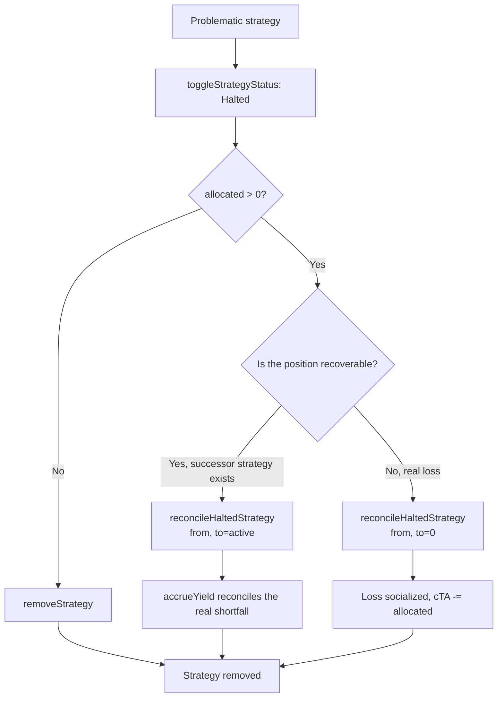

# Halted strategy handling

> How `ConcreteStandardVaultImpl` treats a halted strategy, why removing one requires reconciliation,
> and which tools exist to do it safely.

## TL;DR

- **Halting** a strategy **freezes** it: it stops receiving allocations and is skipped by yield accrual
  and withdrawals. Its `allocated` stays fixed and `cachedTotalAssets` does not change.
- While a strategy is Halted **and still present**, the accounting is consistent. **There is no issue.**
- The problem only appears when **removing** a strategy that still has `allocated > 0`: dropping
  `allocated` without lowering `cachedTotalAssets` inflates the *derived floating amount* (phantom funds).
- For that reason a Halted strategy with an outstanding balance **cannot be removed directly**. It must
  be reconciled first via `reconcileHaltedStrategy(fromStrategy, toStrategy)`:
  - `toStrategy == address(0)` → realize the loss (write-down of `cachedTotalAssets`).
  - `toStrategy != address(0)` → move the position onto an Active strategy (recoverable case).

---

## 1. Context: the derived floating amount

The vault no longer stores the floating amount in storage. It derives it on demand:

```
floating = cachedTotalAssets − SUM(strategy.allocated) + lockedAssets
```

The identity holds because `cachedTotalAssets = legitimate_idle + SUM(allocated)`. Subtracting
`SUM(allocated)` and adding `lockedAssets` yields the floating amount, without relying on `balanceOf`
(immune to donations).

**Key consequence:** the floating amount is now **coupled** to `SUM(allocated)`. Any change to
`allocated` without a matching change in `cachedTotalAssets` breaks the identity.

---

## 2. What halting does (and does not do)

`toggleStrategyStatus` only flips the state `Active ⇄ Halted`. It does **not** touch `allocated` or
`cachedTotalAssets`.

Once Halted, the strategy is:

| Operation | Behavior when Halted |
|---|---|
| `allocate` | Skipped (no new allocations) |
| Withdrawals / deallocation order | Skipped (not unwound to serve withdrawals) |
| `accrueYield` | Skipped: reports **no gain and no loss**; `allocated` stays frozen |
| `cachedTotalAssets` | Unchanged |

> **Important:** halting does **not** realize the loss. If the strategy lost real value, that value is
> still counted in `cachedTotalAssets` until it is explicitly reconciled.

### Is staying Halted safe?

Yes. While a strategy is Halted **and still present** in the vault, its `allocated` is still counted in
`SUM(allocated)`, so the derived floating amount stays exact: nobody can withdraw against that frozen
balance and accrual does not touch it. The only imprecision is *latent*: `cachedTotalAssets` may be
overstated if the strategy lost value (same behavior across every version of the vault), but it does not
break the floating identity.

---

## 3. The problem: removing with `allocated > 0`

If a Halted strategy with `allocated = A` were deleted:

- `SUM(allocated)` drops by `A` (the strategy disappears from the set).
- `cachedTotalAssets` **does not change**.
- ⇒ `floating = cachedTotalAssets − SUM(allocated) + locked` **increases by `A`**: phantom funds that
  are not physically in the vault.

This would enable over-withdrawals and break donation sweeping. That is why **`removeStrategy` now
requires `allocated == 0`** (and that the strategy is out of the deallocation order). A Halted strategy
with a balance must be reconciled first.

---

## 4. The two ways to reconcile

Both live in a single function, `reconcileHaltedStrategy(fromStrategy, toStrategy)`. The underlying
question: are the frozen `A` a **loss** (unrecoverable) or **recoverable** (the funds come back
physically)? The `toStrategy` argument selects the branch.

### 4.1 `reconcileHaltedStrategy(strategy, address(0))` — real loss

For when the position is **unrecoverable** and there is no successor strategy.

- Requires: `fromStrategy` Halted with `allocated > 0`, and `toStrategy == address(0)`.
- Effect: `cachedTotalAssets −= allocated`, deletes the strategy and removes it from the deallocation
  order.
- The loss is **socialized** across all holders (share price drops), just like a negative accrual.
- Events: `StrategyLossRealized(strategy, loss)` and `StrategyRemoved(strategy)`.

**Accounting effect:** `cachedTotalAssets` drops by `A` **and** `SUM(allocated)` drops by `A` →
**floating unchanged** (no phantom).

### 4.2 `reconcileHaltedStrategy(fromStrategy, toStrategy)` — recoverable

For when the position will be **recovered / replaced**, moving it onto a healthy strategy (pass a
non-zero `toStrategy`).

- Requires: `fromStrategy` Halted with `allocated > 0`, and `toStrategy` Active.
- Effect: `toStrategy.allocated += fromStrategy.allocated`, deletes `fromStrategy` and removes it from
  the deallocation order.
- `cachedTotalAssets` and `SUM(allocated)` **do not change** → **floating unchanged, no phantom even
  transiently**, with no need to unwind positions.
- Events: `StrategyAllocationMigrated(from, to, amount)` and `StrategyRemoved(from)`.

**Automatic reconciliation via accrual:** since `toStrategy` is Active, the next `accrueYield` compares
its real value (`totalAllocatedValue`) against its `allocated`:

- If the funds **were recovered** and reached the destination → value == allocated → **no loss**.
- If they **were not recovered** → value < allocated → it realizes the loss automatically
  (`cTA −= shortfall`).

> **The transfer is not booked as a gain.** The migrate branch **raises the destination's cost basis**
> (`allocated`) along with the balance. Since yield / performance fee is only charged on
> `totalAllocatedValue − allocated`, the recovered principal is never accounted as yield.

---

## 5. Decision tree



---

## 6. Accounting effect summary

Initial state: `cachedTotalAssets = C`, Halted strategy with `allocated = A`.

| Action | `cachedTotalAssets` | `SUM(allocated)` | derived floating | Phantom? |
|---|---|---|---|---|
| Stay Halted | `C` | includes `A` | exact | No |
| `removeStrategy` (blocked if `A>0`) | — | — | — | (reverts) |
| `reconcileHaltedStrategy(_, 0)` | `C − A` | `−A` | exact | No |
| `reconcileHaltedStrategy(_, to)` | `C` | unchanged (A moves elsewhere) | exact | No |
| ↳ then accrual, recovered | `C` | reflects real value | exact | No |
| ↳ then accrual, not recovered | `C − A` | `−A` | exact | No |

---

## 7. Roles, pausing and safety

- `reconcileHaltedStrategy` is **`STRATEGY_MANAGER`-only** and `nonReentrant`.
- **It is callable while the vault is paused**, on purpose: it is an incident-response tool. The
  typical flow is: halt → pause the vault → reconcile. Doing the write-down while paused is also
  safer (no user operations racing the share-price change).
- `toggleStrategyStatus` and `removeStrategy` remain `whenNotPaused` (you halt before pausing).

---

## 8. Runbooks

### 8.1 Broken strategy, funds lost (real loss)

1. `toggleStrategyStatus(strategy)` → Halted.
2. (Optional) `pause()` the vault if it is an active incident.
3. `reconcileHaltedStrategy(strategy, address(0))` → realizes the loss and removes the strategy.
4. (Optional) `unpause()`.

### 8.2 Broken strategy, funds recoverable / replacement (migration)

1. `toggleStrategyStatus(broken)` → Halted.
2. (Optional) `pause()`.
3. Ensure an **Active, clean** destination strategy (`addStrategy(new)` if needed).
4. `reconcileHaltedStrategy(broken, new)` → moves the `allocated` and removes the broken one.
5. Move the recovered funds **physically** to the destination (out of band) — ideally within the same
   operational window.
6. `accrueYield()` reconciles: no loss if the funds arrived, or realizes the shortfall if they did not.
7. (Optional) `unpause()`.

---

## 9. Cautions / edge cases

- **Clean destination on migration:** migrating onto a destination strategy that already has
  **unrealized pending yield** (`totalAllocatedValue > allocated`) distorts its yield computation,
  because we raise its basis. Recommendation: migrate onto a freshly added strategy (`allocated == 0`),
  or accrue yield beforehand when safe.
- **Atomicity of fund movement:** after migrating, the destination has `allocated += A` but may not hold
  the physical funds yet. An intermediate `accrueYield` would see the shortfall as a **loss**. If the
  funds are in transit, move funds + reconcile within the same window to avoid realizing a loss that did
  not actually happen.
- **`totalAssets()` vs `cachedTotalAssets()`:** `totalAssets()` previews accrual, so after migrating
  without recovery it already reflects the shortfall as an unrealized loss, while `cachedTotalAssets()`
  stays intact until the next accrual.

---

## 10. API reference

| Function | Role | Pausable | Effect |
|---|---|---|---|
| `toggleStrategyStatus(strategy)` | STRATEGY_MANAGER | `whenNotPaused` | Active ⇄ Halted (freeze/unfreeze) |
| `removeStrategy(strategy)` | STRATEGY_MANAGER | `whenNotPaused` | Removes if `allocated == 0` and out of order |
| `reconcileHaltedStrategy(from, address(0))` | STRATEGY_MANAGER | callable while paused | `cTA −= allocated`, removes (loss) |
| `reconcileHaltedStrategy(from, to)` | STRATEGY_MANAGER | callable while paused | moves `allocated` to Active `to`, removes `from` |

**Relevant errors:** `StrategyHasAllocation` (removing with a balance), `StrategyNotHalted`,
`StrategyHasNoAllocation`, `StrategyIsHalted` (migration destination not Active), `StrategyDoesNotExist`.

**Events:** `StrategyStatusToggled`, `StrategyRemoved`, `StrategyLossRealized`,
`StrategyAllocationMigrated`.
