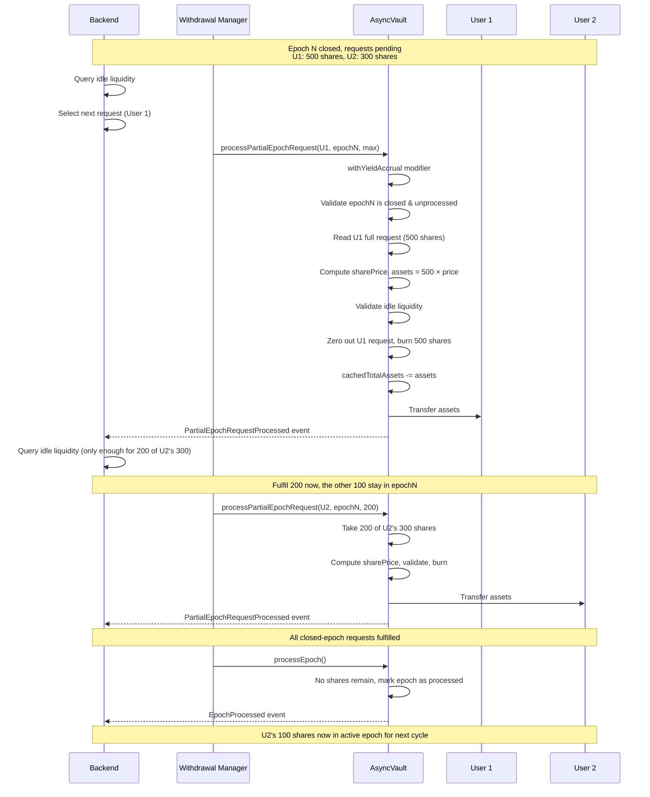

# Partial Epoch Processing: Individual Request Fulfilment

## 1. Summary

Partial Epoch Processing allows the withdrawal manager to fulfil individual withdrawal requests from a closed-but-unprocessed epoch **before** the full epoch is batch-processed via `processEpoch()`. Instead of waiting for all liquidity to be arranged and then settling every request in the epoch at once, the withdrawal manager can progressively drain the epoch request-by-request as idle liquidity becomes available, transferring assets to each user immediately.

This sits between the two existing withdrawal paths:

| Path | Epoch State | Scope | Liquidity Source |
|---|---|---|---|
| Priority Withdrawal | Active (open) epoch | Single user, partial | Idle + freshly deallocated |
| **Partial Epoch Processing** | **Closed, unprocessed** | **Single user, full or partial** | **Idle only** |
| `processEpoch()` | Closed, unprocessed | Entire epoch | Idle only |

---

## 2. Use Case

### Primary Scenario: Progressive Epoch Draining

After an epoch is closed the withdrawal manager begins unwinding strategy positions to prepare liquidity. Rather than waiting for **all** liquidity to arrive before calling `processEpoch()`, the withdrawal manager can fulfil requests one-by-one as funds trickle in from deallocations. This reduces average wait time for users who are early in the queue.

### Key Characteristics

- **Backend-orchestrated**: A backend service (indexing events via subgraphs) maintains a fair request ordering queue and decides which request to fulfil next
- **Idle liquidity only**: Uses vault balance that is not allocated to strategies and not reserved for already-processed epochs — no strategy unwinding or unwind cost
- **Closed epoch only**: Targets requests in a closed-but-unprocessed epoch; requests in the active epoch or already-processed epochs are not eligible
- **Full or partial fulfilment**: `amount` sets how many of the user's shares in the closed epoch are fulfilled; `type(uint256).max` fulfils the entire remaining request. Shares that are not fulfilled stay in the closed epoch and are settled by `processEpoch()`.
- **Immediate transfer**: Assets are transferred to the user in the same transaction — no separate claim step required
- **Exchange rate neutral**: Uses the same yield-accrual-aware share price as `processEpoch()`

---

## 3. Partial Epoch Processing Flow

### Withdrawal Manager Flow (on-chain)

```
Prerequisite: Epoch N is closed (latestEpochID == N+1), epoch N is NOT yet processed.

Step 1: Ensure idle liquidity is available
    Backend ──► Checks vault balance vs pastEpochsUnclaimedAssets
             └──► idleLiquidity = vaultBalance - pastEpochsUnclaimedAssets
             └──► Verifies idleLiquidity >= assets needed for the next request

Step 2: Select request to fulfil
    Backend ──► Queries subgraph for next request in FIFO order
             └──► Determines user for the next fulfilment
             └──► Determines how many of the user's shares to fulfil now
                  (type(uint256).max for the entire request)

Step 3: Execute fulfilment
    Withdrawal Manager ──► vault.processPartialEpochRequest(user, epochID, amount)
        ├── withYieldAccrual modifier runs _accrueYield() first
        ├── Validates epochID is closed and not yet processed (intent check)
        ├── shares = amount (or the entire request for type(uint256).max); must not exceed the request
        ├── Computes share price at current exchange rate
        ├── Calculates assets = shares × sharePrice / 10^decimals (floor)
        ├── Validates idle liquidity ≥ assets
        ├── Reduces userEpochRequests[user][epochID] by shares
        ├── Reduces totalRequestedSharesPerEpoch[epochID] by shares
        ├── Reduces cachedTotalAssets by assets
        ├── Burns shares from vault
        ├── Transfers assets to user
        └── Emits PartialEpochRequestProcessed(user, epochID, shares, assets)

Step 4: Repeat or finalize
    Backend ──► If more requests remain and liquidity is available → repeat Step 2
             └──► When all requests are drained or remaining liquidity is sufficient
                  → call processEpoch() to batch-settle the remainder and mark epoch as processed
```

### Relationship with `processEpoch()`

Partial fulfilments reduce the epoch's `totalRequestedSharesPerEpoch` incrementally. When `processEpoch()` is eventually called, it processes whatever shares remain:

- If all requests were partially fulfilled: `totalRequestedSharesPerEpoch[epochID] == 0` and `processEpoch()` simply marks the epoch as processed with zero assets needed
- If some requests remain: `processEpoch()` batch-settles the residual at the share price at that point in time

The epoch is **not** considered processed until `processEpoch()` is called, even if all individual requests have been fulfilled. This ensures the `epochPricePerSharePlusOne` flag is set consistently for downstream consumers.

---

## 4. Function Specification

### `processPartialEpochRequest`

```solidity
function processPartialEpochRequest(
    address user,
    uint256 epochID,
    uint256 amount
)
    external
    whenNotPaused
    withYieldAccrual
    nonReentrant
    onlyRole(WITHDRAWAL_MANAGER);
```

| Parameter | Type | Description |
|---|---|---|
| `user` | `address` | The user whose closed-epoch request to fulfil. Must not be `address(0)`. |
| `epochID` | `uint256` | The closed epoch to target. Must be closed (`epochID < latestEpochID`) and not yet processed. Serves as an intent-validation parameter to prevent accidental fulfilment against the wrong epoch. |
| `amount` | `uint256` | Number of shares to fulfil. Pass `type(uint256).max` to fulfil the entire remaining request. Must be non-zero and not exceed the user's request. |

Shares of the request that are not fulfilled stay in the closed epoch and are settled by `processEpoch()`. `moveRequestToNextEpoch` can still be used to defer part of a request to the active epoch instead.

### `moveRequestToNextEpoch`

```solidity
function moveRequestToNextEpoch(
    address user,
    uint256 epochID,
    uint256 amount
)
    external
    whenNotPaused
    onlyRole(WITHDRAWAL_MANAGER);
```

| Parameter | Type | Description |
|---|---|---|
| `user` | `address` | The user whose request to partially move. Must not be `address(0)`. |
| `epochID` | `uint256` | Must equal `latestEpochID - 1` (the closed, unprocessed epoch). Intent-validation parameter. |
| `amount` | `uint256` | Number of shares to move. Pass `type(uint256).max` to move the entire request. |

Moves shares from the closed epoch to the current active epoch (`latestEpochID`). This enables partial fulfilment: move the portion to defer, then call `processPartialEpochRequest` to fulfil the remainder.

### Event

```solidity
event PartialEpochRequestProcessed(
    address indexed user,
    uint256 epochID,
    uint256 shares,
    uint256 assets
);
```

| Field | Description |
|---|---|
| `user` | The address of the user whose request was partially fulfilled. |
| `epochID` | The closed epoch from which the request was fulfilled. |
| `shares` | Number of shares burned for this fulfilment. |
| `assets` | Amount of underlying tokens transferred to the user. |

---

## 5. Implementation Logic

```solidity
function processPartialEpochRequest(
    uint256 lockedAssets,   // pastEpochsUnclaimedAssets
    address user,
    uint256 epochID,
    uint256 amount,
    uint8 decimals
) public {
    require(amount > 0);
    uint256 availableAssets = floatingAmount(lockedAssets);
    uint256 sharePrice = convertToAssets(10 ** decimals);   // after yield accrual

    // 1. Validate epoch is the closed one and not processed (intent check)
    uint256 closedEpochID = $.latestEpochID - 1;
    require(epochID == closedEpochID);
    require(!_epochProcessed(closedEpochID));

    // 2. Validate inputs
    require(user != address(0));
    uint256 userRequestedShares = $.userEpochRequests[user][epochID];
    require(userRequestedShares > 0);
    uint256 shares = amount == type(uint256).max ? userRequestedShares : amount;
    require(shares <= userRequestedShares);

    // 3. Calculate assets at current share price
    uint256 assets = shares.mulDiv(sharePrice, 10 ** decimals, Math.Rounding.Floor);
    require(assets > 0);

    // 4. Validate idle liquidity (floating funds minus already-reserved assets)
    require(availableAssets >= lockedAssets + assets);

    // 5. Update epoch bookkeeping
    $.userEpochRequests[user][epochID] -= shares;
    $.totalRequestedSharesPerEpoch[epochID] -= shares;

    // 6. Update vault accounting
    $cached.cachedTotalAssets -= assets;

    // 7. Burn shares held by vault
    _burn(address(this), shares);

    // 8. Transfer assets to user
    IERC20(asset()).safeTransfer(user, assets);

    emit PartialEpochRequestProcessed(user, epochID, shares, assets);
}
```

---

## 6. Accounting Walkthrough

### Numeric Example

```
Before:
    cachedTotalAssets = 10,000    totalSupply = 10,000    exchangeRate = 1.0
    pastEpochsUnclaimedAssets = 0
    vaultBalance (idle) = 3,000
    Closed epoch (ID 5) has 3 requests:
        Alice:  500 shares
        Bob:    300 shares
        Carol:  200 shares
        totalRequestedSharesPerEpoch[5] = 1,000

Fulfilment #1: processPartialEpochRequest(Alice, 5, type(uint256).max)
    shares = userEpochRequests[Alice][5] = 500  (full request)
    sharePrice = 1.0
    assets = 500 × 1.0 = 500
    idle check: 3,000 >= 0 + 500 ✓
    userEpochRequests[Alice][5]: 500 → 0
    totalRequestedSharesPerEpoch[5]: 1,000 → 500
    cachedTotalAssets: 10,000 → 9,500
    totalSupply: 10,000 → 9,500     (500 shares burned)
    vaultBalance: 3,000 → 2,500     (500 transferred to Alice)
    exchangeRate: 9,500 / 9,500 = 1.0 ✓

Fulfilment #2: processPartialEpochRequest(Bob, 5, type(uint256).max)
    shares = userEpochRequests[Bob][5] = 300  (full request)
    sharePrice = 1.0
    assets = 300 × 1.0 = 300
    idle check: 2,500 >= 0 + 300 ✓
    userEpochRequests[Bob][5]: 300 → 0
    totalRequestedSharesPerEpoch[5]: 500 → 200
    cachedTotalAssets: 9,500 → 9,200
    totalSupply: 9,500 → 9,200
    vaultBalance: 2,500 → 2,200
    exchangeRate: 9,200 / 9,200 = 1.0 ✓

Final batch: processEpoch() — settles Carol's remaining 200 shares
    sharePrice = 1.0  (at time of processing)
    assetsNeeded = 200
    idle check: 2,200 >= 0 + 200 ✓
    Burns 200 shares, reserves 200 in pastEpochsUnclaimedAssets
    Marks epoch 5 as processed (epochPricePerSharePlusOne[5] = 1.0 + 1)

Carol claims: claimWithdrawal([5])
    Receives 200 assets from reserved pool
```

### Exchange Rate Preservation

Each fulfilment burns shares and reduces `cachedTotalAssets` by the same proportional amount (using floor rounding that favours the protocol), so the exchange rate is preserved:

```
Before:  rate = cachedTotalAssets / totalSupply
After:   rate = (cachedTotalAssets - assets) / (totalSupply - shares)
         = (cachedTotalAssets - shares × rate) / (totalSupply - shares)
         = rate  ✓ (up to floor rounding in favour of protocol)
```

The `withYieldAccrual` modifier ensures `cachedTotalAssets` reflects the latest strategy values before computing the share price.

---

## 7. Comparison with Priority Withdrawal

| Aspect | Priority Withdrawal | Partial Epoch Processing |
|---|---|---|
| **Target epoch** | Active (open) epoch | Closed, unprocessed epoch |
| **Role** | `PRIORITY_WITHDRAWAL_EXECUTOR` | `WITHDRAWAL_MANAGER` |
| **Unwind cost** | Yes (deducted from user) | No |
| **Strategy interaction** | `adjustTotalAssets(-unwindCost)` | None |
| **Liquidity source** | Idle + freshly deallocated | Idle only |
| **Initiated by** | User (off-chain request) | Backend (automated queue) |
| **Parameters** | `user, sharesToFulfil, unwindCost, strategy` | `user, epochID` |
| **Epoch marked processed?** | N/A (active epoch) | No — requires subsequent `processEpoch()` |

---

## 8. Access Control

| Role | Granted to (default) | Purpose |
|---|---|---|
| `WITHDRAWAL_MANAGER` | Vault Manager | Can call `processPartialEpochRequest` (same role as `processEpoch` and `closeEpoch`) |

---

## 9. Backend Responsibilities

The on-chain contract does not enforce request ordering. The backend service is responsible for:

1. **Request ordering**: Maintaining a FIFO queue of withdrawal requests per epoch, indexed via subgraph events (`QueuedWithdrawal`)
2. **Liquidity monitoring**: Polling vault idle liquidity (`vaultBalance - pastEpochsUnclaimedAssets`) to determine when the next request can be fulfilled
3. **Partial fulfilment** (optional): Passing the number of shares to fulfil as `amount` when only part of a request can be covered; the rest stays in the closed epoch
4. **Fulfilment dispatch**: Calling `processPartialEpochRequest(user, epochID, amount)` for each request in queue order when sufficient idle liquidity is available
5. **Epoch finalization**: Calling `processEpoch()` after all requests have been fulfilled (or when remaining liquidity is sufficient to settle the rest in batch)

### Subgraph Event Indexing

The backend indexes the following events to maintain the request queue:

| Event | Purpose |
|---|---|
| `QueuedWithdrawal(caller, receiver, owner, assets, shares, epochID)` | Track new requests and their insertion order |
| `PartialEpochRequestProcessed(user, epochID, shares, assets)` | Track fulfilments, remove/reduce from queue |
| `EpochClosed(epochID)` | Identify which epoch's requests are eligible for partial processing |
| `EpochProcessed(epochID, shares, assets, sharePrice)` | Mark epoch as finalized, clear remaining queue entries |
| `RequestCancelled(owner, shares, epochID)` | Remove cancelled requests from queue |

---

## 10. Technical Constraints

- `processPartialEpochRequest` can only target the closed-but-unprocessed epoch (`epochID` must equal `latestEpochID - 1` and not be processed yet)
- The epoch must not already be fully processed (`epochPricePerSharePlusOne[epochID] == 0`)
- The user must have a non-zero request in the specified epoch
- `amount` must be non-zero and must not exceed the user's request in the epoch (`type(uint256).max` means the entire request)
- `moveRequestToNextEpoch` only moves requests from the latest closed epoch (`latestEpochID - 1`) to the current active epoch; `epochID` must match the closed epoch and the epoch must not be processed
- Sufficient idle liquidity must be available (`vaultBalance - pastEpochsUnclaimedAssets >= assets`)
- Share price is computed at call time via `withYieldAccrual` + `convertToAssets` — each fulfilment may use a slightly different price if yield has accrued between calls
- The epoch remains in `Processing` state until `processEpoch()` is explicitly called, even if `totalRequestedSharesPerEpoch` reaches zero through individual fulfilments
- Floor rounding on `shares × sharePrice / 10^decimals` ensures the protocol never overpays

---

## 11. Sequence Diagram


